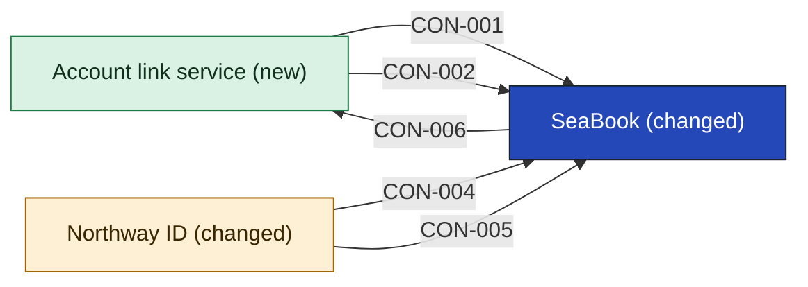

# SeaBook

SeaBook is the ferry web booking engine. It has an availability target of 99.9% from May to September and is on call round the clock (SRC-02). In this cut it also signs ferry customers in through Northway ID, enrols them, and shows their linked accounts. Those three jobs are proposals the lead agreed to when reading back this page.

It does not own the login, which is [[northway-id-building-blocks|Northway ID]], or the link step, which is the [[account-link-service-building-blocks|Account link service]]. It does not keep rail records or hold the household or the loyalty balances. Card payments stay with Tidepay, and FERRYMASTER stays the ledger of record (SRC-02).

- **Options considered:** Login with a link service (picked); Login only, no new app: rejected, it holds the link in two places, leaves the rail-side link with no owner and puts the link step on SeaBook, which Ferry Ops says is frozen; Ferry sign-in adapter: rejected, its adapter has no named owner and the link step still has no app

<!-- generated:app-context sha=12eb78ad: do not edit, run planner render -->

Key: dark blue: the app this page is about · green: new in this initiative · amber: changed by this initiative · an arrow is a contract, labelled with its ID.
<!-- /generated:app-context -->

## Containers

What is inside SeaBook is not recorded: [[11-unknowns-and-risks#UNK-011 How ferry systems relate|UNK-011]]. The two rows below are the only parts this cut touches.

| Container | Job | Contracts served or used | Proposed by | State |
|---|---|---|---|---|
| Booking engine | Takes ferry bookings on the web (SRC-02) | none | SRC-02 | unchanged |
| Sign-in | Signs a ferry customer in through Northway ID | [[northway-id-building-blocks#CON-004 Sign in and person key\|CON-004]], [[northway-id-building-blocks#CON-005 Enrol a ferry customer\|CON-005]] | claude | assumption |

## Contracts this app provides

### CON-006 Ferry customer reference

- **Crosses the boundary:** in, a person key; out, a reference to that person's ferry customer record. It rests on what a ferry customer is across systems and which key ties them: [[11-unknowns-and-risks#UNK-032 What a ferry customer is across systems|UNK-032]], [[11-unknowns-and-risks#UNK-033 Ferry customer key|UNK-033]].
- **Consumers:** [[account-link-service-building-blocks|Account link service]]
- **Change policy:** Not decided: the owner sets it with each consumer before build.
- **Change:** new
- **State:** assumption
- **Options considered:** Login with a link service (picked); Login only, no new app: rejected, it holds the link in two places, leaves the rail-side link with no owner and puts the link step on SeaBook, which Ferry Ops says is frozen; Ferry sign-in adapter: rejected, its adapter has no named owner and the link step still has no app

## Contracts this app consumes

It relies on [[northway-id-building-blocks#CON-004 Sign in and person key|CON-004]] and [[northway-id-building-blocks#CON-005 Enrol a ferry customer|CON-005]] from Northway ID, and on [[account-link-service-building-blocks#CON-001 Link a customer|CON-001]] and [[account-link-service-building-blocks#CON-002 Look up linked records|CON-002]] from the Account link service. Tidepay is untouched.

<!-- generated:contracts-consumed sha=1aa8cfcc: do not edit, run planner render -->
| Contract | Provider | Change policy | State |
|---|---|---|---|
| [[account-link-service-building-blocks#CON-001 Link a customer\|CON-001 Link a customer]] | [[account-link-service-building-blocks\|Account link service]] | Not decided: the owner sets it with each consumer before build. | assumption |
| [[account-link-service-building-blocks#CON-002 Look up linked records\|CON-002 Look up linked records]] | [[account-link-service-building-blocks\|Account link service]] | Not decided: the owner sets it with each consumer before build. | assumption |
| [[northway-id-building-blocks#CON-004 Sign in and person key\|CON-004 Sign in and person key]] | [[northway-id-building-blocks\|Northway ID]] | Not decided: the owner sets it with each consumer before build. | assumption |
| [[northway-id-building-blocks#CON-005 Enrol a ferry customer\|CON-005 Enrol a ferry customer]] | [[northway-id-building-blocks\|Northway ID]] | Not decided: the owner sets it with each consumer before build. | assumption |
<!-- /generated:contracts-consumed -->
