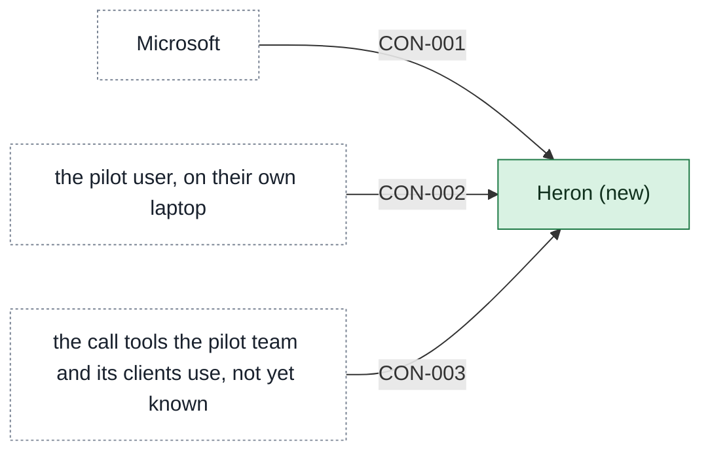

# Building blocks

One page per app in scope, named `<app>-building-blocks.md`. Contracts live on the provider's page.

<!-- generated:context-map sha=46c029ce: do not edit, run vela render -->

Key: green: new in this initiative · white, dashed: outside the initiative (a party or provider) · an arrow is a contract, labeled with its ID.
<!-- /generated:context-map -->

## One laptop app

One app carries the first release: [[heron-building-blocks|Heron]], new, in the Capture area. It reads the calendar and the chosen folder on the laptop, builds the pre-call prep note (the Insight work) and shows it, as one unit to ship, so no text leaves the device. Microsoft stays an outside party.

## History

- **Options considered:** One laptop app (picked); Collector and note builder: rejected, "I don't own anyone yet, and two apps means two ownership questions when I can't answer one."; Laptop agent and cloud summarizer: rejected, "No text off the device in release one, that's the line we hold for the pack."
