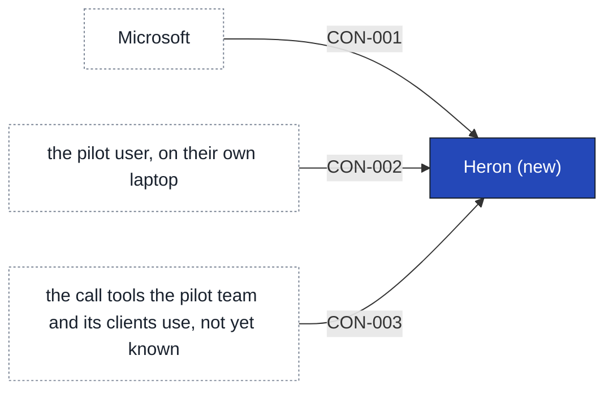

# Heron

About ten minutes before a client call, Heron gives the person one note on who is on the call, what was said last time and what is still open. It builds the note on the person's own laptop from their calendar and one folder they point it at, then shows it. Reading the sources is the Capture area and working out the note is the Insight area, but the two are one thing to ship.

Heron does not read a mailbox or search documents in general, and it writes no morning digest or "what matters today" view. It builds no adoption dashboard, and no text leaves the device in the first release, as [[sources#SRC-06|the CISO's position]] requires. That rules out a cloud service or a hosted model, with or without redaction. If no model on the laptop writes a good enough note, the note is plainer, and there is no hosted fallback. Nobody keeps the digest or the dashboard in the first release. Whether it needs only each person's sign-in is [[11-unknowns-and-risks#UNK-013 Registration or sign-in|still open]], and so is which call tools leave anything to read. @agent-lead takes Heron on @sim-lead's word and has not yet confirmed it, so until they do the team designs the three contracts and the runtime against assumptions, and the four epics stay drafts.

## Containers

| Container | Job | Contracts served or used | Proposed by | State |
|---|---|---|---|---|
| Calendar reader | Reads the person's calendar entries | [[#CON-001 Calendar entries\|Calendar entries]] | claude | assumption |
| Folder reader | Reads the one folder the person points Heron at | [[#CON-002 Chosen folder\|Chosen folder]] | claude | assumption |
| Note builder | Works out who is on the call, what was said last time and what is open (the Insight work) | [[#CON-003 Call tool records\|Call tool records]] | claude | assumption |
| Note view | Shows the note ten minutes before the call, or says why there is none | none | claude | assumption |

## Capabilities

- [[CAP-001-prepare-a-client-for-a-call|Prepare a client for a call]] (new)

## Contracts this app provides

None. Nothing else relies on Heron in the first release.

## Contracts this app consumes

Each of these comes from outside the initiative, so it sits here with its provider.

<!-- generated:contracts-consumed sha=19beb556: do not edit, run vela render -->
| Contract | Provider | Change policy | State |
|---|---|---|---|
| [[heron-building-blocks#CON-001 Calendar entries\|CON-001 Calendar entries]] | [[03-context-and-scope#PTY-01 Microsoft\|Microsoft]] | Not agreed with Microsoft; whether a registration is needed is open as [[11-unknowns-and-risks#UNK-013 Registration or sign-in\|registration or sign-in]]. | assumption |
| [[heron-building-blocks#CON-002 Chosen folder\|CON-002 Chosen folder]] | the pilot user, on their own laptop | Not agreed. Whether the pilot team keeps pointing Heron at a folder every day is open as [[11-unknowns-and-risks#UNK-019 Daily folder habit\|the daily folder habit]]. | assumption |
| [[heron-building-blocks#CON-003 Call tool records\|CON-003 Call tool records]] | the call tools the pilot team and its clients use, not yet known | Not agreed. Which tools are in use is open as [[11-unknowns-and-risks#UNK-008 Call tools in use\|which call tools are in use]], and client Zoom calls as [[11-unknowns-and-risks#UNK-017 Client Zoom transcripts and engagement letters\|client Zoom transcripts and engagement letters]]. | assumption |
<!-- /generated:contracts-consumed -->

### CON-001 Calendar entries

Heron reads the person's calendar entries from Microsoft, with the person's own sign-in.

- **Provider:** [[03-context-and-scope#PTY-01 Microsoft|Microsoft]]
- **Crosses the boundary:** Heron asks for the person's calendar entries, and Microsoft sends the entries with their times, titles and attendees. Nothing goes back.
- **Consumers:** [[heron-building-blocks|Heron]]
- **Change policy:** Not agreed with Microsoft; whether a registration is needed is open as [[11-unknowns-and-risks#UNK-013 Registration or sign-in|registration or sign-in]].
- **Change:** new
- **State:** assumption

### CON-002 Chosen folder

Heron reads the files in the one folder the person points it at, on the same laptop.

- **Provider:** the pilot user, on their own laptop
- **Crosses the boundary:** the person names a folder, and Heron reads the files in it. Nothing is written back.
- **Consumers:** [[heron-building-blocks|Heron]]
- **Change policy:** Not agreed. Whether the pilot team keeps pointing Heron at a folder every day is open as [[11-unknowns-and-risks#UNK-019 Daily folder habit|the daily folder habit]].
- **Change:** new
- **State:** assumption

### CON-003 Call tool records

Heron reads what each call tool leaves behind about a call, such as notes or a transcript.

- **Provider:** the call tools the pilot team and its clients use, not yet known
- **Crosses the boundary:** the call tool leaves notes or a transcript, and Heron reads them. Nothing goes back.
- **Consumers:** [[heron-building-blocks|Heron]]
- **Change policy:** Not agreed. Which tools are in use is open as [[11-unknowns-and-risks#UNK-008 Call tools in use|which call tools are in use]], and client Zoom calls as [[11-unknowns-and-risks#UNK-017 Client Zoom transcripts and engagement letters|client Zoom transcripts and engagement letters]].
- **Change:** new
- **State:** assumption

<!-- generated:app-context sha=a722d99f: do not edit, run vela render -->

Key: dark blue: the app this page is about · white, dashed: outside the initiative (a party or provider) · an arrow is a contract, labeled with its ID.
<!-- /generated:app-context -->

## Requirements allocated

| Requirement | Share | Through | State |
|---|---|---|---|
| [[CAP-001-prepare-a-client-for-a-call#CAP-001.FR1 Note before a client call\|Note before a client call]] | builds one note for each client call as soon as the call is known and shows it ten minutes before the start; a call booked or moved to start inside ten minutes gets its note as soon as it can be built; a moved call is shown ten minutes before its new time; for a canceled call it shows no note and withdraws one already built; only for calls counted as client calls | CON-001 | assumption |
| [[CAP-001-prepare-a-client-for-a-call#CAP-001.FR1 Note before a client call\|Note before a client call]] | obligation of CON-001: Microsoft's calendar sends each entry with its time and attendees, and sends any move or cancellation, so Heron can act on the change before the note is due | CON-001 | assumption |
| [[CAP-001-prepare-a-client-for-a-call#CAP-001.FR2 Who is on the call\|Who is on the call]] | lists the people on a client call from the person's own calendar entry and nowhere else; everyone invited appears except those who have declined; someone who joins without being invited does not appear; a list in the invitation is expanded only when the entry names its members; each person is shown by name and organization only | CON-001 | assumption |
| [[CAP-001-prepare-a-client-for-a-call#CAP-001.FR2 Who is on the call\|Who is on the call]] | obligation of CON-001: each calendar entry carries every invitee's name and organization, whether each has accepted or declined, and the members of a list when the entry names them | CON-001 | assumption |
| [[CAP-001-prepare-a-client-for-a-call#CAP-001.FR3 Last time and what is open\|Last time and what is open]] | finds the most recent earlier call with the same client and gives a short account of it and the points still open from it, drawn only from what the call tool left behind about that call and from files in the chosen folder; an open point appears only when a call tool record or a folder file states it as open, and the note says which; it adds no open point of its own; when the most recent earlier call left nothing readable, the note says so and does not reach back to an older call; it carries no remark about anyone's mood, tone or performance | CON-001, CON-002, CON-003 | assumption |
| [[CAP-001-prepare-a-client-for-a-call#CAP-001.FR3 Last time and what is open\|Last time and what is open]] | obligation of CON-003: for each call the call tool leaves a readable record, such as notes or a transcript, that can be tied to that call; where it leaves none, Heron says so | CON-003 | assumption |
| [[CAP-001-prepare-a-client-for-a-call#CAP-001.FR3 Last time and what is open\|Last time and what is open]] | obligation of CON-002: the files in the chosen folder can be read, and nothing is written back | CON-002 | assumption |
| [[CAP-001-prepare-a-client-for-a-call#CAP-001.FR3 Last time and what is open\|Last time and what is open]] | obligation of CON-001: past calendar entries come with their attendees, as well as coming ones, so the most recent earlier call with the same client can be found | CON-001 | assumption |
| [[CAP-001-prepare-a-client-for-a-call#CAP-001.FR4 The person chooses the folder\|The person chooses the folder]] | lets the person name one folder and change it later; reads nothing of the person's apart from that folder, the calendar and the call tools' records, with no mailbox and no general document search; after a change of folder the next note uses the new one; until a folder is chosen the note says that no folder is set; when the folder is missing or empty the note says so, naming the problem; from a folder that holds files for several clients it uses only the files that relate to the call's client, matched as for CAP-001.FR3 | CON-002 | assumption |
| [[CAP-001-prepare-a-client-for-a-call#CAP-001.FR4 The person chooses the folder\|The person chooses the folder]] | obligation of CON-002: the person can name a folder on the same laptop and change it later, and Heron can tell whether the folder is missing or empty | CON-002 | assumption |
| [[CAP-001-prepare-a-client-for-a-call#CAP-001.FR5 A note, or the reason for none\|A note, or the reason for none]] | gives every client call either a note or a short message saying why there is none; a first call with a client gets a note that says there is no earlier call and still lists who is on the call; when what the call tool left behind cannot be read, the message says so; a note not ready by ten minutes before the call is shown as soon as it is ready, clearly marked as late, and is not dropped; a message never takes the place of the list of who is on the call, when that is known | CON-001, CON-003 | assumption |

## History

- **Options considered:** One laptop app (picked); Collector and note builder: rejected, "I don't own anyone yet, and two apps means two ownership questions when I can't answer one."; Laptop agent and cloud summarizer: rejected, "No text off the device in release one, that's the line we hold for the pack."
- **Decision:** [[2026-10-11-privacy-m365-device-line]]
- **Decision:** [[2026-10-12-heron-handoff]]
- **Override:** GATE-5, E805 by @sim-lead on 2026-10-12: "The CISO pack is due 10 November and the team cannot design the contracts while this waits." This also waives the handoff checklist: the three contracts are at `assumption`, the runtime page is at `assumption`, the four epics are at `draft`, and UNK-010 and the other unknowns that block the epics are open (GATE-4 for the epics, which stay open).
- **Decided by:** @sim-lead, on behalf of @agent-lead
