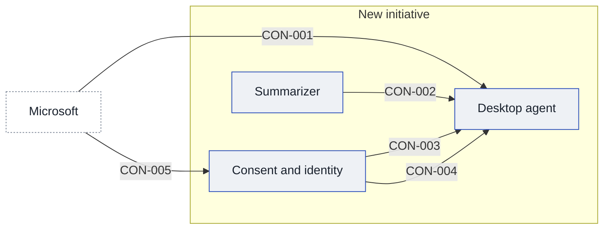

# Context and scope

Marlowe is a firm of about 4,200 people on one Microsoft 365 tenant, with software pushed to every laptop by the IT team. This page records what runs on the desks today and the outside parties the work depends on. What is in and out of scope is not yet written.

## Today

Marlowe has [[sources#SRC-013|one Microsoft 365 tenant with about 4,200 users]]. The tenant note counts about 3,100 Windows PCs managed by Intune and about 1,100 Macs managed by Jamf. The same note says staff cannot install software, because everything is pushed from Intune or Jamf; [[02-constraints#Constraints|the constraints page]] says what that forces on Heron.

Microsoft 365 already lets the work read calendar and mail with each user's own consent. Teams transcripts exist only where the organizer turned them on, and they sit in the organizer's OneDrive, and reading them needs tenant admin approval. A Graph app registration is raised through the identity team, per [[sources#SRC-013|the tenant note]].

Any new app registration on the tenant needs the CISO's security review first, which takes [[sources#SRC-009|about six weeks]]. The review is [[sources#SRC-010|booked for the week of 16 November 2026]], with the pack due on 10 November and the outcome due on 4 December. Frankfurt has about 600 staff and a works council, per [[sources#SRC-013|the tenant note]].

## After

<!-- generated:system-context sha=78408140: do not edit, run vela render -->

Key: blue outline: an app in the initiative · white, dashed: outside the initiative (a party or provider) · an arrow is a contract, labeled with its ID.
<!-- /generated:system-context -->

## In scope

- [[desktop-agent-building-blocks|Desktop agent]]
- [[summarizer-building-blocks|Summarizer]]
- [[consent-and-identity-building-blocks|Consent and identity]]

## Out of scope

## Outside parties

### PTY-01 Microsoft

Microsoft supplies the tenant, Teams, Outlook and the Graph interface that Heron would read through, so what Heron may see depends on what Microsoft 365 exposes and what the tenant admins approve.

- **Relationship:** supplier
- **Agreements:** none known

### PTY-02 Clients

Marlowe's clients are the people on the other side of Client Delivery's calls. The solution lead says Marlowe holds engagement terms with them, and nobody has checked what those terms or each client's own terms say about a digest or about reading transcript text.

- **Relationship:** customer group
- **Agreements:** Marlowe's client engagement terms and each client's own terms, none registered as a source yet

### PTY-03 Zoom

Zoom carries a large share of Client Delivery's meetings, by the solution lead's account, and the product owner's one-pager says Heron would read it. The solution lead says the terms that govern Zoom calls with clients matter if Heron reads them, and nothing recorded says what those terms allow or how Heron would read a Zoom meeting.

- **Relationship:** supplier
- **Agreements:** none known
