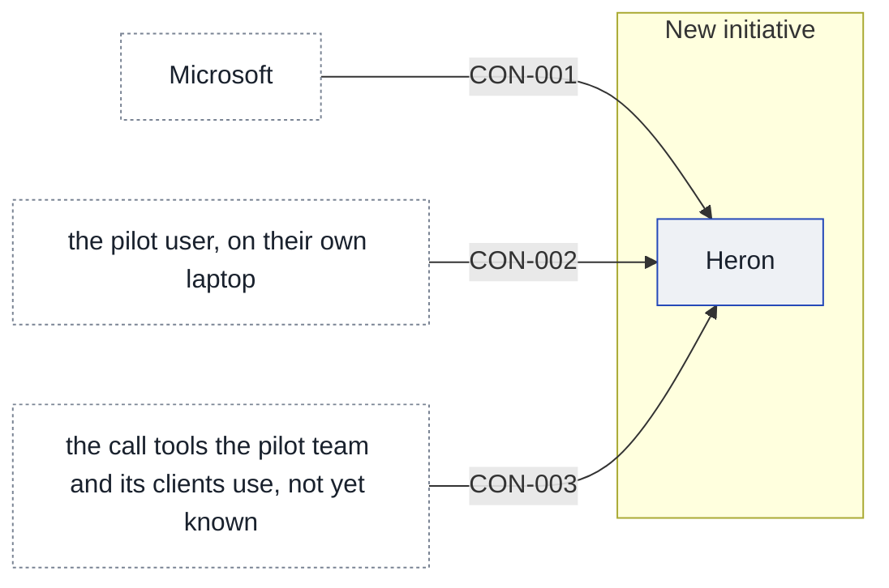

# Context and scope

The desk helper is meant first for a pilot with the Client Delivery team in London, about 60 people led by Sam Hadley. The solution lead believes the team lives on client calls and that the helper will not be used if it does not work there. How much of their work comes from calls is [[11-unknowns-and-risks#UNK-009 Basis of the 70 percent figure|not yet confirmed]], and what the helper reads, and where, is [[11-unknowns-and-risks#UNK-006 What data Heron reads|still to be found out]].

## Today

[[sources#SRC-03|The IT endpoint lead's tenant note]] describes one Microsoft 365 tenant with about 4,200 users. It counts 3,100 Windows PCs managed through Intune and 1,100 Macs managed through Jamf, and says staff cannot install software themselves, which is [[02-constraints#Constraints|recorded as a constraint]]. It says Teams transcripts exist only where the meeting's organiser turned them on, and that they sit in the organiser's OneDrive. A Graph app registration is raised through the identity team, and the note says calendar and mail can be read with each user's own consent while reading transcripts needs tenant admin approval. It also says Frankfurt has about 600 staff and a works council.

## After

[[sources#SRC-02|The CIO's brief]] expects staff to install Heron themselves in two minutes, and expects it to run on the PC so that the data never leaves the machine and nothing is left for privacy or the works councils to worry about. It expects that staff choosing to install covers consent, that Heron needs only each person's own Microsoft 365 sign-in, and that it is in use firm-wide by the summer. [[sources#SRC-04|The product one-pager]] expects Heron to read Teams, Zoom, Outlook and documents, and to write a 7:30 digest each morning and a prep note ten minutes before each meeting. It expects the agent on the laptop to collect, with a cloud service writing the summaries using a hosted language model, and a pilot starting on 2 February 2027 with Client Delivery. These are plans, and they are assumptions until a Grill decides them.

<!-- generated:system-context sha=1d543cdb: do not edit, run planner render -->

Key: blue outline: an app in the initiative · white, dashed: outside the initiative (a party or provider) · an arrow is a contract, labelled with its ID.
<!-- /generated:system-context -->

## In scope

The pilot is Sam Hadley's Client Delivery team in London, about 60 people. The app in scope is [[heron-building-blocks|Heron]].

## Out of scope

## Outside parties

### PTY-01 Microsoft

Microsoft supplies the tenant, Teams, Outlook, OneDrive and the Graph that Heron would read from, as [[sources#SRC-03|the tenant note]] describes them.

- **Relationship:** supplier
- **Agreements:** none known

### PTY-02 Zoom

[[sources#SRC-04|The product one-pager]] expects Heron to read Zoom meetings. Whether Zoom is in use at the firm is not recorded.

- **Relationship:** supplier
- **Agreements:** none known
