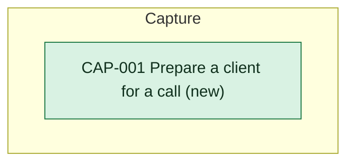

# Capability delta

Every capability this initiative changes. Each capability page holds what provides it today and after.

- [[CAP-001-prepare-a-client-for-a-call|Prepare a client for a call]]

<!-- generated:capability-map sha=96aaf3bb: do not edit, run planner render -->

<!-- /generated:capability-map -->

## Allocation

<!-- generated:allocation sha=fb694646: do not edit, run planner render -->
**Allocation:** 5 requirements at assumption or later, 0 not allocated.

| Requirement | [[heron-building-blocks\|Heron]] |
|---|---|
| [[CAP-001-prepare-a-client-for-a-call#CAP-001.FR1 Note before a client call\|CAP-001.FR1]] | builds one note for each client call as soon as the call is known and shows it ten minutes before the start; a call booked or moved to start inside ten minutes gets its note as soon as it can be built; a moved call is shown ten minutes before its new time; for a cancelled call it shows no note and withdraws one already built; only for calls counted as client calls (CON-001); obligation of CON-001: Microsoft's calendar sends each entry with its time and attendees, and sends any move or cancellation, so Heron can act on the change before the note is due (CON-001) |
| [[CAP-001-prepare-a-client-for-a-call#CAP-001.FR2 Who is on the call\|CAP-001.FR2]] | lists the people on a client call from the person's own calendar entry and nowhere else; everyone invited appears except those who have declined; someone who joins without being invited does not appear; a list in the invitation is expanded only when the entry names its members; each person is shown by name and organisation only (CON-001); obligation of CON-001: each calendar entry carries every invitee's name and organisation, whether each has accepted or declined, and the members of a list when the entry names them (CON-001) |
| [[CAP-001-prepare-a-client-for-a-call#CAP-001.FR3 Last time and what is open\|CAP-001.FR3]] | finds the most recent earlier call with the same client and gives a short account of it and the points still open from it, drawn only from what the call tool left behind about that call and from files in the chosen folder; an open point appears only when a call tool record or a folder file states it as open, and the note says which; it adds no open point of its own; when the most recent earlier call left nothing readable, the note says so and does not reach back to an older call; it carries no remark about anyone's mood, tone or performance (CON-001, CON-002, CON-003); obligation of CON-003: for each call the call tool leaves a readable record, such as notes or a transcript, that can be tied to that call; where it leaves none, Heron says so (CON-003); obligation of CON-002: the files in the chosen folder can be read, and nothing is written back (CON-002); obligation of CON-001: past calendar entries come with their attendees, as well as coming ones, so the most recent earlier call with the same client can be found (CON-001) |
| [[CAP-001-prepare-a-client-for-a-call#CAP-001.FR4 The person chooses the folder\|CAP-001.FR4]] | lets the person name one folder and change it later; reads nothing of the person's apart from that folder, the calendar and the call tools' records, with no mailbox and no general document search; after a change of folder the next note uses the new one; until a folder is chosen the note says that no folder is set; when the folder is missing or empty the note says so, naming the problem; from a folder that holds files for several clients it uses only the files that relate to the call's client, matched as for CAP-001.FR3 (CON-002); obligation of CON-002: the person can name a folder on the same laptop and change it later, and Heron can tell whether the folder is missing or empty (CON-002) |
| [[CAP-001-prepare-a-client-for-a-call#CAP-001.FR5 A note, or the reason for none\|CAP-001.FR5]] | gives every client call either a note or a short message saying why there is none; a first call with a client gets a note that says there is no earlier call and still lists who is on the call; when what the call tool left behind cannot be read, the message says so; a note not ready by ten minutes before the call is shown as soon as it is ready, clearly marked as late, and is not dropped; a message never takes the place of the list of who is on the call, when that is known (CON-001, CON-003) |
<!-- /generated:allocation -->
