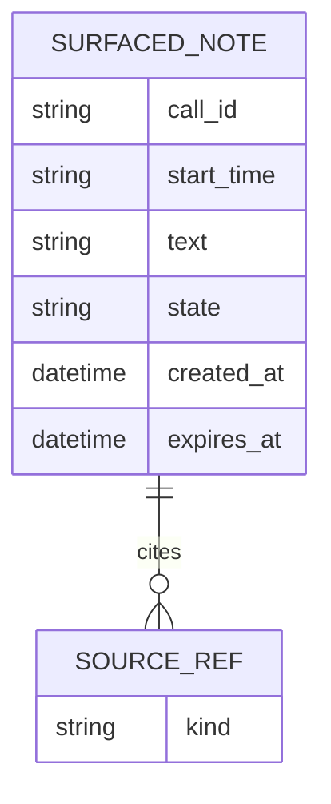
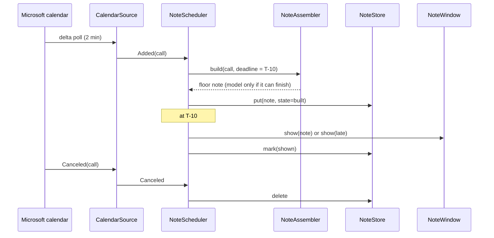

# Tech Design — Heron desktop agent

Vault links below name `c410421`. Vault text is not copied here.

## Architecture overview

One per-user background app, one Tauri 2 codebase (Rust core, small web UI for the note window) for Mac and Windows, one process with four internal modules, one per APP-heron container. Chosen for binary size and the memory budget left for the on-device model. Microsoft sign-in is a public-client OAuth PKCE flow through the system browser; tokens sit behind `SignIn` and `TokenStore` interfaces so the mechanism can change without touching the modules. Shipped as a signed `.msi` (Intune) and `.pkg` (Jamf), per CST-2.

## Note building

Two layers inside the Note builder. The deterministic floor (Rust) does everything the requirements pin down: the attendee list, the most recent earlier call, which records and files count, and open points taken only where a record or file states them as open, each labeled with its source. An optional on-device model rewrites the extracted text into a short account; it never decides which points exist. Its output passes a check that each sentence maps to a source span and carries no remark on mood, tone or performance. If the model is absent, too slow or fails the check, the note shows the extracted text plainly. No hosted fallback (CST-3).

First iteration may ship without the model; the floor alone must meet every EPC-003 criterion except that "short account" (EPC-003.AC1) would read as excerpts, which the product owner must accept.

## Integration points
| System | Direction | Protocol | Auth |
|--------|-----------|----------|------|
| Microsoft calendar (CON-001) | in | Graph calendar delta query, polled every 2 min while awake and signed in; catch-up on wake and start; targeted re-poll at T-15 for the next 15 minutes; 7-day window; past entries read on demand per client | public-client OAuth PKCE, the person's own sign-in; registration open (UNK-013, OQ-001) |

The interval is one constant. The delta token is kept in `NoteStore`. One failed poll marks the calendar unconfirmed (diagnostics log only); five minutes without a good poll marks it stale, and the tray and the Note view say so. Build is deadline-aware: the floor runs first and is stored; the model rewrite runs only if it can finish before T-10, otherwise the floor note is shown, and a shown note is never swapped in place.

## Call tool records

`RecordSource` is a port with one adapter per call tool; each answers with a record, none left, or unreadable. No adapter is built until UNK-008 and UNK-017 name the tools. Until then every call resolves to "none readable" (EPC-003.AC3, EPC-004.AC3). The first adapter is a new consent and registration question, not a code detail. Vault dates: UNK-008 ask-by 2026-10-18, UNK-017 and UNK-025 ask-by 2026-11-01, IT packaging slot 2027-01-18, pilot 2027-02-02. This design's reading: treat 2026-11-01 as the latest useful date for UNK-008; after that release one ships with "none readable". Until records exist, the floor and the model are tried on files in the chosen folder alone.

## Client-call and client-match rules

`CallClassifier` and `ClientMatcher` are interfaces; the rules are configuration. Provisional defaults, both assumptions tied to open unknowns: a client call has at least one invitee outside the firm's own email domains (UNK-021); the same client is the external invitees' email domain, and a folder file relates to the client when its path contains the client's name or domain or its text names them (UNK-022). Alternates shipped: a calendar tag or category, and the call tool named in the invitation. The Note view shows which rule is active. No match for an earlier call gives the first-call note, never an older call. The rule choice and the firm's domains come from managed settings (Intune policy on Windows, Jamf configuration profile on Mac), read at start and on change; the person cannot change them. Settings are read from machine-scope locations only (the Windows policy key under HKLM, Mac managed preferences from a configuration profile); a per-user key or a file in the user's home is ignored. If settings are missing or invalid, Heron fails closed: it builds no notes, and says why in the tray and at T-10 ("Heron's settings from IT haven't arrived"); it never falls back to a default domain list. Term-list additions can only add terms; the base list in the build cannot be removed by settings. A settings change applies to notes not yet shown. Each stored note records the rule that built it; unshown notes are rebuilt after a switch, shown notes keep theirs. A rule kind that is not shipped needs a new build through IT's update channel.

## Failure behavior

Sign-in or keychain failure (review finding 1). `CalendarSource` returns `Token`. The tray icon shows a warning badge while sign-in is dead. A signed-out episode runs from the first failed refresh to the next good poll. One notification fires per episode, only when a client call is due inside the lead window (default 4 hours); one reminder fires at T-30 for the next client call if sign-in is still dead. The reason shows in the Note view at T-10 only, never as an all-day banner. A good poll ends the episode, runs a catch-up from the saved delta token, builds the notes due, clears the badge and withdraws the notification. A note built before the failure still shows at T-10, marked "calendar not confirmed". The lead window and the reminder are managed settings (OQ-005). The wording of the message waits on OQ-002.

## Rollback, kill switch and signing (review finding 11)

Managed settings `enabled` and `model`. `enabled=false` dominates: Heron stops note display and polling, never starts the model child, kills a running one and shows "paused by IT" in the tray, whatever `model` says. `enabled=true` with `model=false` is floor only. All settings are read as one snapshot at start and on change, after a 5-second quiet period, so the design does not depend on Intune or Jamf applying values atomically (unverified). Rollback: IT re-pushes the previous signed build. The store has a version table and ordered forward-only migration scripts, a backup of the database is taken before migrating, and a rollback after a breaking change restores the backup. A non-breaking schema change stays readable by the previous build; a breaking change either migrates (one script and a fixture from the prior version) or discards and recreates the store (finding 8); the release notes say when a rollback loses stored history. A release test installs N+1, then N, on both OSes. Before the 18 January slot the design needs in place: spike results (OQ-001), managed-settings delivery (OQ-005), memory and timing numbers (OQ-003), and a signed build handed to IT; the owner (OQ-010) signs these off.

## Sign-in redirect (review finding 10)

Default: loopback on `127.0.0.1` only, a random free port chosen per sign-in, one request accepted, then closed. Every sign-in uses a fresh `state` and a PKCE verifier; the code is exchanged only if `state` matches and the verifier is ours, and the nonce is checked on the ID token. The deep-link plugin is compared in the spike and used only if it proves safer, since on some OSes any app can claim a custom scheme. The spike runs on a pilot-class laptop under Intune or Jamf with its endpoint security, firewall, proxy or VPN and browser policy, not a clean one, and includes a second process that tries to bind first and to replay the code; sign-in must fail safe in both cases. The laptop is a request to the endpoint lead (OQ-005, UNK-011).

## Registration, scopes and schedule (review finding 9)

Delegated permissions only: `Calendars.Read`, `offline_access` and `User.Read`. No shared-calendar scope, no mail, no files, no write scope, no application permissions. The design assumes user consent is enough; if the tenant requires admin consent, that is the identity team's step and lengthens the review (question for the endpoint lead). Reading earlier entries uses the same scope (R-REG-08 asks whether it needs a second registration). The client ID and the tenant authority are managed settings, not compiled in, so the sign-in spike (OQ-001) can run against a test registration in a developer tenant now, and the production registration later changes only a settings value; whether a developer tenant is available is part of the spike. Proposed tripwires, not decisions: 16 Oct (UNK-015 ask-by), 11 Dec (has the 4 December outcome arrived), 8 Jan (is the registration approved); if 8 Jan is missed, choose between slipping the pilot and a different calendar source (OQ-009).

## Store key and recovery (review finding 8)

The encryption protects the store at rest if the laptop is lost or the disk copied; it does not protect against malware running as the user, and the design does not claim it does. The key is bound to the app: on Mac, the keychain item's access list names the signed Heron binary only; on Windows the key is wrapped with DPAPI, as is the encrypted-file token fallback (OQ-001). The key is per install and destroyed on sign-out or uninstall. If the store will not open or Graph rejects the delta token, Heron deletes the store and the token, recreates them and does a full resync of the 7-day window; shown and dismissed states are lost and a seen note may show again for a call still ahead; the tray says "Heron reset its local data" and the log records the reason code and counts resets. Release tests wipe the keychain entry, corrupt the database, and update from one signed build to the next and read the key, on both OSes. A profile push does not normally wipe the keychain; the realistic triggers are an admin password reset, a re-image or re-enrollment, an account migration and a change of signing identity (unverified for this MDM setup; the endpoint lead confirms, OQ-001).

## Folder matching (review finding 7)

A file relates to the client only on an exact match: the full domain, or the full client name as a whole word, never a substring; names and domains on a public-mail list never identify a client. Only plain text, Markdown, Word and PDF files are read, up to a size cap and a file-count cap per client (defaults 2 MB and 50 files), skipping hidden and system folders. The kinds and caps are managed settings, which IT can tighten without a rebuild. The Note view shows each file used by name, with the reason ("path contains the client's domain"), at build time. File names and paths are not stored and not logged: `StoredNote` has no name or path field, so `NoteStore.put` replaces a name with its kind ("a file in the chosen folder"); the log carries a reason code only. A shown note reopened after a restart shows the kind of source, not the file; a note not yet shown is rebuilt on restart and gets its names back. Personal data in the files stays with the DPO (R-DAT-08, R-DAT-15).

## Excluded population (review finding 6)

`PopulationFilter` (Calendar reader) sits between `CalendarSource` and everything else. It takes the exclusion list from managed settings and drops excluded attendees from the people list, from past-entry matching and from the stored note. A call whose only external attendees are excluded gets no note and the reason "excluded attendee". The exclusion list must be declared: an explicitly empty list means IT has said nobody is excluded; an absent list means it has not arrived, and Heron fails closed (no notes, with the reason in the tray and at T-10). The list comes in the same payload as the firm's domains (OQ-005). The policy (drop the person, drop the call, or something else) is open as OQ-008 under UNK-018; the works council data list must say that past entries are read.

## Names in extracted text (review finding 5)

Interim, until the DPO answers UNK-023 and UNK-024: the floor drops any extracted sentence that names a person not on the call's attendee list, and the withheld count says so. Name detection is imperfect; the design does not claim the DPO's rule is met (OQ-007). `name_filter` is a managed setting, `strict` (default) or `off`, with an allow-list of tokens that look like names but are not; turning it `off` needs the DPO's agreement on record, a procedure the code cannot enforce. Each stored note records the level it was built under. A change to how names are detected is a rebuild. If the DPO says invitees who never join cannot be named, `NoteAssembler` changes in one place: the people list shows only those who accepted. Before the pilot, a labeled test set from consenting or synthetic records scores misses and false alarms; the log splits the withheld count by reason (name, mood or tone, no source).

## Throttling and stale calendar (review finding 4)

On a 429 or 503 `CalendarSource` honors `Retry-After`; with none it backs off 30 s, 1, 2 and 5 minutes, then stays at 5. The T-15 re-poll is skipped while throttled. A note built from a stale calendar still shows at T-10, marked "calendar not confirmed since HH:MM"; the marker appears only when the last good poll is older than the threshold at T-10. The first good poll applies every move and cancellation from the saved delta token, withdraws notes for canceled calls and re-times moved ones. The stale threshold, the backoff steps, the lead window and the idle unload are managed settings with built-in defaults, used when a value is absent; only the rule choice and the firm's domains fail closed. The log counts how often the marker was shown and how often a cancellation arrived after a note was shown.

## Keeping it running (review finding 3)

The installer sets the app to start at login (a login item on Mac, a scheduled task or Run entry on Windows) and to restart after a crash. The tray menu has no "quit" in the pilot, only "pause until tomorrow". The model runs in a child process with a hard time limit and a memory cap, started on demand, serving one build at a time, and unloaded after an idle timeout (default 2 minutes, a managed setting). The floor note is stored before the child starts, so a hung, killed or out-of-memory child costs only the rewrite. On start or wake the scheduler loads unshown rows, catches up from the delta token and shows anything now due as late; if the app was not running through T-10 the late note says so. Rows stuck at "built" after a crash are rebuilt on start. Release tests close the lid for 10 minutes and kill the app mid-build, on both OSes. `Rewriter` stays a port, so moving the model in-process later touches only its adapter, at the cost of the isolation.

## Risks & mitigations
| ID | Risk | Severity | Mitigation |
|----|------|----------|-----------|
| R-2 | The registration review closes after 8 January, leaving days to test sign-in before the 18 January packaging slot | high | client ID in settings; spike on a developer tenant now; tripwires; OQ-009 |
| R-1 | Without call-tool records the pilot cannot show whether the notes are worth showing | high | try the floor and the model on chosen-folder files; settle UNK-008 by 2026-11-01 |

## Operations
- **Deploy:** IT pushes a signed `.msi` (Intune) and `.pkg` (Jamf); updates only through IT's channel, no self-updater (CST-2).
- **Monitor:** a local diagnostics log of a closed list of codes: call IDs, timings, states, poll results, the reason no note was shown. No names, note text or file paths, and no free text. A "Save diagnostics" button exports it. No remote telemetry in release one; the sink is deferred as D-001 behind a `Diagnostics` interface. Whether the export friction bites is measured in the pilot.
- **Scale:** one app per laptop, no scaling axis; the limits are memory (C-1), build time and Graph throttling.

## Data model

- **Persistence:** `NoteStore` (Note view container): SQLCipher database, key held in the OS keychain. One row per surfaced note: the note as shown with file names and paths replaced by the kind of source, its source kinds, and its state (built, shown, dismissed, late). Rows expire 30 days after creation, swept at start and daily. A canceled call deletes its row. A note already shown is never rebuilt; the sources stay the authority for notes not yet shown. The store is a decision of the user's made outside the vault.

## Constraints register
| ID | Constraint | Source | Impact |
|----|-----------|--------|--------|
| C-3 | Surfaced notes kept in an encrypted SQLite store, 30-day expiry | user, this session (not in the vault) | notes with names and call content sit on disk; see OQ-004 |
| C-1 | App memory budget 500 MB with the bundled model | user, this session (not in the vault) | model size and runtime must fit; unmeasured, see OQ-003 |
| C-2 | No text leaves the device | CST-3, INI-001 @ c410421 | no hosted model, no remote summarizer |

## Tech stack
| Layer | Choice | Rationale |
|-------|--------|-----------|
| App shell | Tauri 2, Rust core | binary size and memory budget with the ML model (decided by the user) |
| Sign-in | OAuth PKCE, system browser, loopback or deep link | public client, no secret on the laptop; unproven on both OSes, see OQ-001 |
| Token store | OS keychain via `keyring`, behind `TokenStore` | Windows credential size cap may force an encrypted file; see OQ-001 |
| Packaging | signed `.msi` and `.pkg` | CST-2: IT pushes through Intune and Jamf |

## Context boundaries
**Inside the app:** APP-heron, one laptop app with four containers: Calendar reader, Folder reader, Note builder, Note view (APP-heron Containers table @ c410421).
**Outside the app:** Microsoft calendar (CON-001), the pilot user's chosen folder (CON-002), call tool records (CON-003). No provider is agreed for any of the three (all `assumption`).

## Vault readout (before the first question)

- Handoff was waived by override (APP-heron History, GATE-5 / E805): contracts, RUN-heron and the four epics are not accepted pages. `planner handoff verify APP-heron` exits 0.
- Vault clone: only `.planner/explorer-pins.json` is modified; no planner page is.
- Allocation table is present, so the split of each CAP-001 requirement between apps is the vault's, not this design's.
- Trace targets: 11 allocated rows (CAP-001.FR1..FR5 @ APP-heron), CON-001..003 consumed, no contract provided, 23 epic criteria (EPC-001.AC1..7, EPC-002.AC1..6, EPC-003.AC1..5, EPC-004.AC1..5).

## ADRs
- [ADR-0001](../adr/0001-desktop-agent-deterministic-floor.md) — Build the note in two layers, a deterministic floor with an optional on-device rewriter

## Components

The core (`NoteAssembler`, `NoteScheduler`, `CallClassifier`, `ClientMatcher`) imports no OS, network or model code. `CalendarSource`, `FolderSource`, `RecordSource`, `Rewriter`, `NoteStore`, `Diagnostics`, `SignIn` and `TokenStore` are ports; their adapters (Graph client, filesystem, call-tool adapters, model runtime, SQLCipher, keychain) sit outside it.

### CalendarSource
- Responsibility: reads calendar entries and their moves and cancellations over CON-001, coming and past, with attendees.
- Owns: the delta token; the stale/fresh state of the calendar.
- Depends on: SignIn, TokenStore, Diagnostics.
- Exposes: `upcoming()`, `changes()`, `earlier_calls(client)`.
- Container: Calendar reader

### SignIn / TokenStore
- Responsibility: sign the person in with OAuth PKCE through the system browser; keep tokens in the OS keychain.
- Owns: tokens.
- Depends on: none.
- Exposes: `token()`, `sign_in()`.
- Container: Calendar reader

### FolderSource
- Responsibility: holds the one chosen folder and reads its files read-only; reports unset, missing or empty.
- Owns: the folder choice.
- Depends on: Diagnostics.
- Exposes: `choose(path)`, `status()`, `files_for(client)`.
- Container: Folder reader

### CallClassifier and ClientMatcher
- Responsibility: decide whether a call is a client call, and which client a call and its earlier calls and files belong to, by the active rule.
- Owns: the rules and their provisional defaults.
- Depends on: ManagedSettings.
- Exposes: `is_client_call(entry)`, `client_of(entry)`, `same_client(a, b)`.
- Container: Note builder

### ManagedSettings
- Responsibility: reads the rule choice and the firm's domains from the IT-pushed settings.
- Owns: nothing; read-only.
- Depends on: none.
- Exposes: `rules()`.
- Container: Note builder

### RecordSource
- Responsibility: for a call, returns the call tool's record, none left, or unreadable; one adapter per tool.
- Owns: the adapter list.
- Depends on: none.
- Exposes: `record_for(call)`.
- Container: Note builder

### NoteAssembler
- Responsibility: the deterministic floor: attendee list, the most recent earlier call, extracted open points with their source, and the first-call, no-folder, empty-folder and unreadable-record cases; runs the content check on every note, model or not: drops extracted sentences that match the mood, tone and performance list or map to no source span, and says how many were withheld and why.
- Owns: note content, its source spans, the content check and its term list (base list in the build, additions from ManagedSettings, version recorded on each stored note).
- Depends on: CalendarSource, FolderSource, RecordSource, CallClassifier, ClientMatcher, Rewriter.
- Exposes: `build(call, deadline)`.
- Container: Note builder

### Rewriter
- Responsibility: optionally rewrites checked text into a short account on the device; its output goes through the NoteAssembler check again; absent, failing or declined, the floor text stands.
- Owns: the model.
- Depends on: none.
- Exposes: `rewrite(extract, deadline)`.
- Container: Note builder

### PopulationFilter
- Responsibility: drops excluded attendees (Frankfurt staff, CST-8) from everything built from calendar entries; fails closed when the exclusion list has not arrived.
- Owns: nothing; reads the exclusion list from ManagedSettings.
- Depends on: ManagedSettings.
- Exposes: `filter(entries)`.
- Container: Calendar reader

### NoteScheduler
- Responsibility: owns the timeline: build on discovery, show at T-10, build at once for a call inside ten minutes, re-time on a move, withdraw on a cancel, mark late, guarantee every client call a note or a reason.
- Owns: the schedule of upcoming calls.
- Depends on: CalendarSource, NoteAssembler, NoteStore, NoteWindow, Diagnostics.
- Exposes: none outside the app.
- Container: Note view

### NoteStore
- Responsibility: keeps surfaced notes and their state in the encrypted store with 30-day expiry; reconciles with the calendar on start.
- Owns: SURFACED_NOTE rows and the delta token.
- Depends on: TokenStore (for the key).
- Exposes: `put`, `get`, `mark`, `delete`, `sweep`.
- Container: Note view

### NoteWindow
- Responsibility: shows the note, or the reason for none, and the active rule; says when the calendar is stale.
- Owns: presentation only.
- Depends on: NoteScheduler.
- Exposes: the window.
- Container: Note view

### Diagnostics
- Responsibility: records a closed list of codes locally, telling network, throttle and token failures apart; exports on request.
- Owns: the local log.
- Depends on: none.
- Exposes: `emit(code, fields)`, `export()`.
- Container: Note view

## Responsibility matrix
| Component | Owns | Reads from | Writes to |
|-----------|------|------------|-----------|
| CalendarSource | delta token, calendar freshness | Microsoft calendar | NoteStore (token) |
| SignIn / TokenStore | tokens | Microsoft sign-in | OS keychain |
| FolderSource | folder choice | chosen folder | none |
| CallClassifier, ClientMatcher | rules | ManagedSettings | none |
| ManagedSettings | none | Intune policy, Jamf profile | none |
| PopulationFilter | none | CalendarSource, ManagedSettings | none |
| RecordSource | adapter list | call tool records | none |
| NoteAssembler | note content, source spans | CalendarSource, FolderSource, RecordSource | none |
| Rewriter | model | checked extract | none |
| NoteScheduler | schedule | CalendarSource, NoteStore | NoteStore, NoteWindow |
| NoteStore | surfaced notes | none | encrypted SQLite |
| NoteWindow | presentation | NoteScheduler | none |
| Diagnostics | local log | every component | local log file |

## API contracts
Ports are in-process interfaces, not network APIs.
- `CalendarSource`: `upcoming() -> [Entry{id,start,end,title,attendees[{name,org?,response}],list_members?}]`, `changes() -> [Added|Moved|Canceled]`, `earlier_calls(client) -> [Entry]`. Errors: `Network`, `Throttled`, `Token`, `Stale`.
- `FolderSource`: `status() -> Unset|Missing|Empty|Ok`, `files_for(client) -> [File]`.
- `RecordSource`: `record_for(call) -> Record|None|Unreadable`.
- `NoteAssembler`: `build(call, deadline) -> Note{people[], account?, open_points[{text,source}], reason?}`. Never returns a guessed note; no earlier call gives the first-call note.
- `Rewriter`: `rewrite(extract, deadline) -> Text|Declined`.

## Key flows

## NFRs
| Concern | Target | How enforced |
|---------|--------|--------------|
| Note on time | note ready before T-10 shown within 30 s of T-10; later notes shown when ready, marked late (CAP-001.FR5); measured, relax if the model always misses it | `NoteScheduler` timer, tested with a fake clock |
| Build time | measured (OQ-003); floor alone is the safe path | deadline-aware build |
| Memory | at most 500 MB resident with the model (C-1), unmeasured | measured on a pilot-class laptop; model dropped if it will not fit |
| No text off device | no outbound calls except Microsoft sign-in and calendar reads | test that blocks other network access; no remote telemetry (D-001) |
| No invented content | every sentence maps to a source span; no mood, tone or performance remark | content check in NoteAssembler on every note, model or not; withheld count shown; list tested on consenting or synthetic records before the pilot |
| Read-only | nothing written to the chosen folder or the calendar | read-only handles; test |
| Staleness | calendar stale after 5 minutes without a good poll (managed setting, default 5): the Note view says so, never a guessed note; the log tells network, throttle and token failures apart so the line can be tuned | poll state; Diagnostics codes |
| Retention | notes expire 30 days after creation (C-3) | expiry sweep |

## Trace
| Target | Component |
|--------|-----------|
| CAP-001.FR1@APP-heron (share) | NoteScheduler |
| CAP-001.FR1@APP-heron (obligation of CON-001) | CalendarSource |
| CAP-001.FR2@APP-heron (share) | NoteAssembler |
| CAP-001.FR2@APP-heron (obligation of CON-001) | CalendarSource |
| CAP-001.FR3@APP-heron (share) | NoteAssembler |
| CAP-001.FR3@APP-heron (obligation of CON-003) | RecordSource |
| CAP-001.FR3@APP-heron (obligation of CON-002) | FolderSource |
| CAP-001.FR3@APP-heron (obligation of CON-001) | CalendarSource |
| CAP-001.FR4@APP-heron (share) | FolderSource |
| CAP-001.FR4@APP-heron (obligation of CON-002) | FolderSource |
| CAP-001.FR5@APP-heron (share) | NoteScheduler |
| CON-001 | CalendarSource |
| CON-002 | FolderSource |
| CON-003 | RecordSource |
| EPC-001.AC1 | NoteScheduler |
| EPC-001.AC2 | NoteScheduler |
| EPC-001.AC3 | NoteScheduler |
| EPC-001.AC4 | NoteScheduler |
| EPC-001.AC5 | NoteAssembler |
| EPC-001.AC6 | NoteAssembler |
| EPC-001.AC7 | CalendarSource |
| EPC-002.AC1 | FolderSource |
| EPC-002.AC2 | FolderSource |
| EPC-002.AC3 | NoteAssembler |
| EPC-002.AC4 | NoteAssembler |
| EPC-002.AC5 | ClientMatcher |
| EPC-002.AC6 | FolderSource |
| EPC-003.AC1 | NoteAssembler |
| EPC-003.AC2 | NoteAssembler |
| EPC-003.AC3 | NoteAssembler |
| EPC-003.AC4 | RecordSource |
| EPC-003.AC5 | NoteAssembler |
| EPC-004.AC1 | NoteScheduler |
| EPC-004.AC2 | NoteAssembler |
| EPC-004.AC3 | NoteAssembler |
| EPC-004.AC4 | NoteScheduler |
| EPC-004.AC5 | NoteAssembler |

## Open questions
### OQ-001: Do system-browser OAuth and the OS keychain work on Mac and Windows with no fallback?
**What we know:** Loopback redirect with PKCE is allowed by Microsoft for public clients; `keyring` covers Keychain and Credential Manager. Windows caps a stored credential near 2.5 KB; a refresh token may not fit. A client ID needs an Entra registration whatever the flow, which bears on UNK-013.
**What would unblock:** A spike on one Mac and one Windows pilot-class laptop actually managed by Intune or Jamf, with its endpoint security, firewall, proxy or VPN and browser policy (lent by the endpoint lead), against a test registration: sign in, store, restart, refresh, no prompts, with the largest token a pilot account gets.
**Affects:** CON-001, EPC-001.AC1, EPC-001.AC3, Calendar reader

### OQ-003: Where do we land on the 500 MB budget with the bundled model, and is the model-free first iteration acceptable?
**What we know:** The budget is the user's, not in the vault; unclear whether it means resident memory or install size. Pilot laptops are unknown (UNK-027).
**What would unblock:** Measure peak memory of the parent and the model child together (and the webview on its own) and end-to-end build time (detection to note ready, floor alone and with the model) on a pilot-class laptop with Teams and a browser open. If the sum goes over 500 MB, in order: a smaller or more quantized model, a shorter idle unload, the floor only, in-process last. Ask the product owner whether excerpt-style notes meet "short account".
**Affects:** Note builder, EPC-003.AC1, EPC-004.AC4

### OQ-004: Does the DPO, Legal and the works council data list accept built notes kept on the laptop for 30 days?
**What we know:** The store holds attendee names and account text drawn from call records and folder files. The vault leaves where a note is kept and for how long open as R-DAT-09.
**What would unblock:** Answers to UNK-024 and UNK-025, and the store added to the list the works council reads (UNK-006).
**Affects:** NoteStore, CAP-001.FR2, CAP-001.FR3

### OQ-005: Can IT deliver managed settings to Heron on both platforms?
**What we know:** The rule choice, the firm's domains, the lead window and term-list additions are meant to arrive as an Intune policy and a Jamf profile. Nobody has asked IT. Heron fails closed without them, so a laptop without the policy builds no notes: this is a hard dependency of the pilot.
**What would unblock:** The endpoint lead commits to both channels and a delivery date before the 2027-01-18 slot.
**Affects:** CallClassifier, ClientMatcher, ManagedSettings, EPC-001.AC1, EPC-002.AC5
**Challenges:** UNK-011. The vault is silent on how settings reach laptops. Scenario: the app is packaged on 18 January but the policy is not, so every pilot laptop shows no notes on 2 February. Raise with `/planner:challenge UNK-011`.

### OQ-006: Who maintains the mood, tone and performance term list, and does a word list satisfy the DPO?
**What we know:** A word list is incomplete by nature. The DPO's rule is CST-6. The vault names no owner for Heron (UNK-010, UNK-028). Real records need a lawful basis to test on (UNK-025).
**What would unblock:** The owning team named; the DPO states the scope and accepts or rejects a filter as meeting the rule (with UNK-024); a measured miss rate on consenting or synthetic records.
**Affects:** NoteAssembler, EPC-003.AC5, CAP-001.FR3

### OQ-007: Does a name filter on extracted text satisfy the DPO's rule that a note names only people in the meeting?
**What we know:** The floor drops sentences naming anyone off the call's attendee list. Free-text name detection misses and misfires. The vault has UNK-023 (invitees who never join) and UNK-024 (reach of the rule) open with the DPO.
**What would unblock:** The DPO's answer to UNK-023 and UNK-024, and a measured miss and false-alarm rate on a labeled set.
**Affects:** NoteAssembler, CAP-001.FR2, CAP-001.FR3, EPC-001.AC5, EPC-003.AC1

### OQ-008: What is the policy for Frankfurt staff in past and coming entries: drop the person, drop the call, or something else?
**What we know:** Frankfurt stays out of the pilot (CST-8). Past entries are read to find the last call and name attendees. The design drops excluded attendees and fails closed without a declared list. The vault has UNK-018 open and says nothing of past entries.
**What would unblock:** The CISO's and the DPO's answer to UNK-018; the works council data list saying past entries are read.
**Affects:** PopulationFilter, CAP-001.FR2, CAP-001.FR3, EPC-001.AC5, EPC-001.AC7

### OQ-009: What happens to the pilot if the registration review does not close by early January?
**What we know:** CST-4: a new registration needs about six weeks of review; CST-5: the outcome of the November review is due 4 December. If the registration review starts after that, it ends about mid-January, near the 18 January packaging slot and the 2 February pilot. The design has no fallback. One candidate, reading the installed Outlook client locally, is unverified and would change CON-001's provider.
**What would unblock:** The CISO's office says whether the registration review is separate from the November one (UNK-015) and when it starts; a decision on the 8 January tripwire; whether a local calendar read is possible at all.
**Affects:** CalendarSource, SignIn, CON-001, EPC-001.AC1, EPC-001.AC7
**Challenges:** UNK-015. Scenario: the registration review closes after 8 January, so sign-in cannot be tested before packaging on 18 January. Raise with `/planner:challenge UNK-015`.

### OQ-010: Who owns Heron, and so holds the signing keys and operates the pilot?
**What we know:** The owner holds the Mac and Windows signing certificates, can ship an emergency patch outside the 18 January slot, operates the kill switch, supports the pilot team, maintains the term list (OQ-006) and pays. The vault says @agent-lead has not confirmed (UNK-010) and the source of the CTO's naming is not known (UNK-028).
**What would unblock:** Settled when UNK-010 is, with UNK-028 giving the source of the naming, and not before. This is the one owner gate on the design: OQ-006 and the kill switch depend on it.
**Affects:** every component's operation, Operations, ADR-0001 follow-up, the design's status

### OQ-002: No requirement says what the person sees when the calendar cannot be read
**What we know:** RUN-heron says Heron then shows no note and says why; EPC-004 names the gap as out of scope because no CAP-001 requirement holds it.
**What would unblock:** A requirement on CAP-001, then allocation to APP-heron.
**Affects:** Note view, CAP-001.FR5
**Challenges:** CAP-001. Scenario: sign-in expires overnight, the 09:50 client call has no note and no message. Raise with `/planner:challenge CAP-001`.
