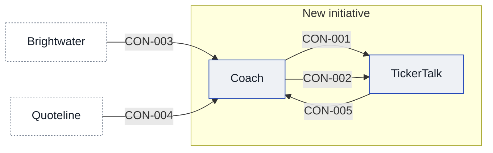

# Context and scope

TickerTalk is the foundation: an app, its readers and a mobile team. The product lead says about 400,000 people read it each month, and does not know whether the coach is for all of them or only those interested in trading. The coach is meant to take on one stock or option at a time. [[03-context-and-scope#PTY-01 Brightwater|Brightwater]], a broker-dealer TickerTalk signed with in June, holds the customers' money and executes equity orders through its API, and its agreement covers equities and not options. TickerTalk holds none of that money, and, on the partnerships manager's account, Brightwater carries the balances as money it owes its own customers. [[03-context-and-scope#PTY-02 Quoteline|Quoteline]] supplies the prices, under a license that lets TickerTalk's own apps display US equity quotes delayed by 15 minutes, with no options data. A budget has been allocated, but its size, holder and scope are not recorded, and the dates and the no-live-trading ban are on the constraints page. [[sources#SRC-15|The product lead's own account]] is that a contractor, now locked in, writes the lessons, though the product lead does not have the name to hand. The product lead also defines what "ready" means for the track, and has not yet worked out what it looks like.

## Today

The product lead says TickerTalk is the foundation: the app, the readers and a mobile team. They also say "users are TickerTalk readers, about 400k monthly", and that the budget is allocated. All three are the product lead's account and none has a source. The agreement and license summaries call TickerTalk "Kestrel", and [[sources#SRC-07|the product lead confirms]] they are the same company.

[[sources#SRC-16|The answers the product lead gathered by 9 October]] fill in more of what runs today. They say the CEO wants the coach offered to every TickerTalk reader, with only readers who opt in seeing lessons, and release one aimed at the roughly 40,000 readers who use watchlists; that is a target, so it is an assumption, and it is a narrower scope than the 400,000 monthly readers, not a clash with it. They say the product lead defines "ready" for the paper track as three graded paper trades on different stocks from the list plus every lesson for them. TickerTalk has a backend on Kestrel's AWS account, according to the CTO, and the Coach service runs there. The Coach lead says Coach keeps each reader's paper balance and trades while the Brightwater sandbox only fills the paper orders, and expects that record to stay in Coach if a reader later opens a real account, which is an assumption. The mobile lead says TickerTalk identifies a signed-in reader by an opaque reader ID and not the email, and may send that ID to Coach, and that the Coach rendering tests fit before mobile's sign-off without pushing other work. The platform engineer's security review found no payment data and no real orders in Coach, and says practice records are stored encrypted. The product lead says the compliance consultant signs off each lesson before Brightwater's review, a process still to run and so an assumption. The CEO says the January demo is shown to the five board members and herself, inside Kestrel, which is also an assumption until the demo happens.

[[sources#SRC-19|The product lead sets the rule for grading]]: a paper trade passes when the reader states why they entered it, sets a stop, and closes it within the lesson's rules, and three passes on different stocks pass the ready track.

## After

<!-- generated:system-context sha=bc841d11: do not edit, run planner render -->

Key: blue outline: an app in the initiative · white, dashed: outside the initiative (a party or provider) · an arrow is a contract, labeled with its ID.
<!-- /generated:system-context -->

## In scope

- [[coach-building-blocks|Coach]], a new service for the lessons, the stock list and the paper record
- [[tickertalk-building-blocks|TickerTalk]], the news app, changed to add the coach screens and to send Coach the reader ID

## Out of scope

[[sources#SRC-16|The answers the product lead gathered]] say that in release one the coach never suggests a trade, and its lessons only explain how a trade works using the fixed list. Options are taught as reading only: never paper-traded, with no trade screen. Both are the product lead's account of release one. [[sources#SRC-08|Outside Counsel's reply]] separately rules out TickerTalk trading on a customer's behalf in the first release.

[[sources#SRC-16|The same answers]] say the ML lead owns Signal and that Signal stays out of release one.

## Outside parties

### PTY-01 Brightwater

Brightwater is the broker-dealer TickerTalk signed with in June. [[sources#SRC-03|The partnerships manager's agreement summary]] says it opens accounts, runs KYC, holds customers' money and executes equity orders through its API, and that TickerTalk gets back an account ID and an order status and never holds customer money. The same summary says the agreement covers equities and not options, and that sandbox paper accounts are available for testing. [[sources#SRC-11|Partnerships' reading of the signed agreement in full]] confirms the equities-only scope and adds that options need a separate options agreement. It says Brightwater holds customers' balances as its own customers' money while TickerTalk never holds any, that the sandbox covers all US-listed equities, and that either side may leave with 90 days' notice. [[sources#SRC-13|Brightwater's own written reply]] says the Coach service may send paper orders to the sandbox through the existing API, and may show Brightwater's quotes inside its trade screens; it does not say whether those quotes are delayed or cover options. It says every lesson and screen shown to Brightwater's customers goes through Brightwater's content review first, which takes ten business days, and that live options trading needs its options agreement and each customer's options approval. Whether a reader who only paper-trades counts as a Brightwater customer for that review is not recorded.

[[sources#SRC-16|The answers the product lead gathered]] add that the partnerships manager has read the signed agreement in full. Brightwater carries every customer balance as money it owes its own customers, Kestrel carries none, and paper balances are not money. Section 7.2 puts every customer-facing lesson and screen under Brightwater's content review, including demo builds shown outside Kestrel. The review is run by Brightwater's marketing compliance team, and the contact is its review lead, reached through the partnerships manager's shared channel. Brightwater will not shorten the ten-business-day review; a rejected item restarts the clock, with two rounds allowed before escalation; and a demo shown only inside Kestrel is exempt, with the board counting as inside Kestrel. Brightwater gives ten sandbox test accounts, run by its integration QA engineer. Brightwater's own reply speaks of content shown to its customers, while the partnerships manager's reading reaches demo builds shown outside Kestrel, so a demo shown to outsiders is the case between the two and is not yet settled.

[[sources#SRC-19|The partnerships manager relays]] that Brightwater has replied that it will not act as recommender or supervisor for trade ideas in year one. Keeping trade ideas out of release one follows from that and is a plan, so it is an assumption.

- **Relationship:** partner
- **Agreements:** the signed broker agreement, June (year not recorded), held by the partnerships manager; [[sources#SRC-13|Brightwater's written reply]], [[sources#SRC-11|Partnerships' read of it in full]] and [[sources#SRC-03|the earlier summary]] are in sources, and the terms on consent, data and live trading are still open in [[11-unknowns-and-risks#UNK-009 Signed broker agreement terms|the question on its terms]]

### PTY-02 Quoteline

Quoteline supplies the market data under a license. [[sources#SRC-04|The data engineer's license summary]] says it lets TickerTalk's own apps display US equity quotes delayed by 15 minutes, and that it includes no options data. [[sources#SRC-10|Quoteline's own reply]] says showing delayed quotes inside lessons is display use, which the license allows, and that using its prices to train or run a model is non-display use that needs an addendum with its own fees, as clause 9 says. [[sources#SRC-16|The partnerships manager's full reading of the license]] is that clause 9 allows display inside lessons and valuing paper positions on delayed quotes, and forbids training models without an addendum. [[sources#SRC-28|Quoteline's later reply]] settles the valuing question: it says valuing paper balances and positions on its delayed quotes is display use, inside the license, with no addendum and no fee, which [[11-unknowns-and-risks#UNK-038 Valuing paper trades on Quoteline quotes|the question to Quoteline]] asked. Its replies say nothing about filling paper orders at delayed prices, and the license text itself is not held.

- **Relationship:** supplier
- **Agreements:** the Quoteline market data license, summarized by the data engineer in March 2026 ([[sources#SRC-04|the summary]]); [[sources#SRC-10|Quoteline's reply of 7 October]] on clause 9; [[sources#SRC-28|its reply of 9 October]] on valuing paper positions; the license itself is not in sources

### PTY-03 Outside Counsel

Outside Counsel is the legal adviser whose written reply on the first release is in sources. [[sources#SRC-08|The reply]] says lessons and paper trading may launch once the marketing, and any results shown to users, have been reviewed. It says a trade idea for a particular customer, this stock or this option now, counts as a recommendation, allowed only as Brightwater's recommendation under its duty to act in the customer's best interest and its supervision. It says TickerTalk must not trade on a customer's behalf in the first release, that options lessons are education, and that a live options trade needs Brightwater's options approval for that customer. Who reviews the marketing and the shown results is not recorded. [[sources#SRC-16|The answers the product lead gathered]] relay that counsel confirmed on 8 October that lessons are education and not marketing, and that only promotions and any shown results need marketing review.

- **Relationship:** supplier
- **Agreements:** none known

### PTY-04 Fieldnote Learning

Fieldnote Learning is the contractor that writes the lessons, which fits [[sources#SRC-15|the product lead's account]] that a locked-in contractor does. [[sources#SRC-16|The answers the product lead gathered]] name it as the contracted lesson writer and say it starts on 12 October; the start date is a plan, so it is an assumption. [[sources#SRC-19|The product lead holds the contract and says]] Kestrel owns the lessons, either side may end it on 30 days' notice, and the compliance consultant checks each lesson before it is paid for.

- **Relationship:** supplier
- **Agreements:** the lesson-writing contract, held by the product lead; [[sources#SRC-19|the later answers]] give its main terms and [[sources#SRC-16|the answers file]] names the contractor, and the contract itself is not in sources

## Value held for customers

### SV-01 Customer money at Brightwater

Brightwater holds the money customers put in, and TickerTalk holds none, on [[sources#SRC-01|the product lead's own account]].

- **Holder:** [[03-context-and-scope#PTY-01 Brightwater|Brightwater]]
- **Owner:** [[03-context-and-scope#PTY-01 Brightwater|Brightwater]], which carries the balances as money owed to its own customers, per [[sources#SRC-16|the partnerships manager]]
