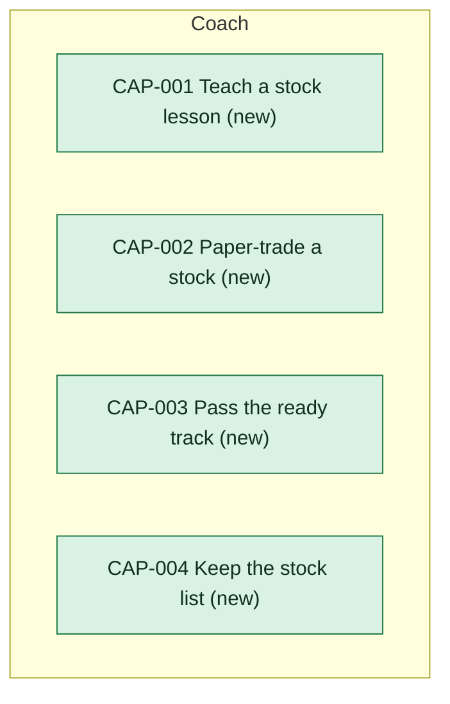

# Capability delta

The first release adds four capabilities, all new and all provided by [[coach-building-blocks|Coach]]: teaching a stock lesson, paper-trading a stock, passing the ready track and keeping the stock list. Each capability page says what provides it.

<!-- generated:capability-map sha=e9516e59: do not edit, run planner render -->

<!-- /generated:capability-map -->

## Capabilities

- [[CAP-001-teach-a-stock-lesson|Teach a stock lesson]]
- [[CAP-002-paper-trade-a-stock|Paper-trade a stock]]
- [[CAP-003-pass-the-ready-track|Pass the ready track]]
- [[CAP-004-keep-the-stock-list|Keep the stock list]]
