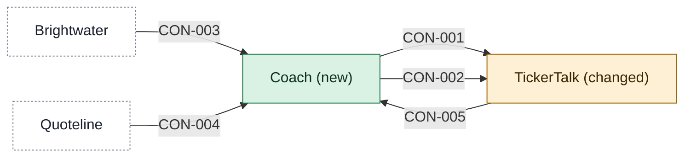

# Building blocks

This page holds the cut picked for the first release. Each app in scope has its own page, named `<app>-building-blocks.md`, and a contract lives on its provider's page.

## A Coach service behind TickerTalk

The picked cut for the first release. The coach is a new service, Coach, that holds the lessons, the ready track, the stock list and each reader's paper record, and TickerTalk, the news app, only gains the screens that show them. Whether TickerTalk has somewhere to run a service is [[11-unknowns-and-risks#UNK-028 Where a Coach service can run|still open]].

[[coach-building-blocks|Coach]] is a new app and [[tickertalk-building-blocks|TickerTalk]] is a changed one. Brightwater and Quoteline stay outside parties that the apps integrate with, described under [[03-context-and-scope#PTY-01 Brightwater|Brightwater]] and [[03-context-and-scope#PTY-02 Quoteline|Quoteline]].

## History

- **Options considered:** A Coach service behind TickerTalk (picked); Coach inside TickerTalk: rejected, the product lead says "news app stays news"; Coach plus a paper-trading gateway: rejected, two new services for a January demo and a seam that only pays off once real orders exist (Claude's reason, the product lead gave none)

<!-- generated:context-map sha=56ca60b0: do not edit, run planner render -->

Key: green: new in this initiative · amber: changed by this initiative · white, dashed: outside the initiative (a party or provider) · an arrow is a contract, labelled with its ID.
<!-- /generated:context-map -->
