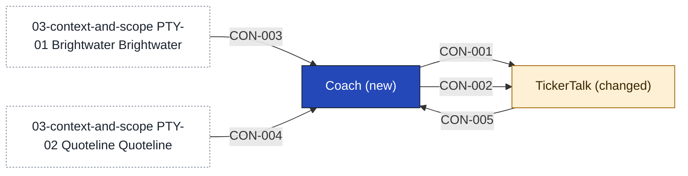

# Coach

Coach is the new service behind TickerTalk's coach screens. It teaches one stock at a time through lessons, keeps the ready track and each reader's progress, holds the list of about 50 stocks as data, and lets each reader paper-trade on Brightwater's sandbox accounts. Coach is the record of each reader's paper balance and trades, and the record stays in Coach if the reader later opens a real account, as the Coach lead says in [[sources#SRC-16|the answers the product lead gathered]]. For each reader it holds only the opaque reader ID, lesson progress, stock picks, and paper orders, balance and trades, and it uses none of that for any other purpose; [[11-unknowns-and-risks#UNK-042 Opt-in language for Coach's reader records|the opt-in language]] that lets Coach hold them is still to be settled in writing with the privacy lead. It also holds the release switch that gates the paper-trading part, as the product lead decided in [[2026-10-09-first-instruments#^c06]]. The product lead's own call is that the list is data, so a ruling from counsel changes the list and not the build ([[2026-10-09-first-instruments#^c05]]). The four containers below are confirmed. The Coach lead has confirmed [[11-unknowns-and-risks#UNK-043 When Coach's on-call rota starts|when the on-call rota starts]], but how their own names for the containers map to these four is still open ([[11-unknowns-and-risks#UNK-046 Coach lead's names for the containers|the names]]).

Coach places no real order and trades nothing for a reader, because [[sources#SRC-08|Outside Counsel's reply]] bars it in the first release. It covers no options, gives no trade idea for a particular reader, holds no money, which stays with Brightwater, and draws no screens, which stay in TickerTalk. It does not use Signal in release one. It does not write the lessons: Fieldnote Learning does, and starts on 12 October according to the product lead. It runs on Kestrel's AWS account, run by the Coach team, according to the CTO. Until Quoteline answers whether [[11-unknowns-and-risks#UNK-038 Valuing paper trades on Quoteline quotes|valuing paper trades on its quotes]] is display use, Coach shows a reader's cash balance and positions at fill price and computes no valued balance. Who covers Coach out of hours is not recorded, and the data concern has not been examined.

<!-- generated:app-context sha=d93846d2: do not edit, run planner render -->

<!-- /generated:app-context -->

## Containers

| Container | Job | Contracts served or used | Proposed by | State |
|---|---|---|---|---|
| Lessons and track | Holds the lessons, the ready track and each reader's progress | [[#CON-001 Lessons and track\|Lessons and track]] | claude | confirmed |
| Stock list | Holds the list of about 50 stocks as data, and the release switch | [[#CON-001 Lessons and track\|Lessons and track]] | claude | confirmed |
| Paper trading | Keeps the reader's paper balance and trades, with Coach as the record, and links to the sandbox; shows cash balance and positions at fill price until valuing them on quotes is answered | [[#CON-002 Paper trades\|Paper trades]], [[#CON-003 Brightwater sandbox\|Brightwater sandbox]] | claude | confirmed |
| Price reader | Reads delayed quotes from Quoteline, shown labelled as delayed and used for display only | [[#CON-004 Quoteline delayed quotes\|Quoteline delayed quotes]] | claude | confirmed |

## Contracts this app provides

### CON-001 Lessons and track

Carries the lessons, the stock list and a reader's progress from Coach to TickerTalk, so the screens can show where the reader is and whether they are ready.

- **Crosses the boundary:** in, the reader's identity and the lesson they are on; out, the lessons, the stock list, the reader's progress and whether they are ready
- **Consumers:** [[tickertalk-building-blocks|TickerTalk]]
- **Change policy:** Coach only adds to the contract; removing or renaming anything needs TickerTalk's agreement, and Coach keeps serving the old shape until mobile says the last app version that uses it is retired
- **Tested by:** Coach, a provider test that serves lessons, list and progress, including a dropped stock's progress still counting toward ready, and that no field is removed or renamed; TickerTalk (mobile), a consumer test that the coach screens render from Coach's example responses
- **Change:** new
- **State:** decided

### CON-002 Paper trades

Carries a reader's paper orders from TickerTalk to Coach and their positions, balance and prices back, so no real order ever crosses.

- **Crosses the boundary:** in, a stock pick and a paper order; out, positions, balance, order status and delayed prices
- **Consumers:** [[tickertalk-building-blocks|TickerTalk]]
- **Change policy:** Coach only adds to the contract; removing or renaming anything, including an order status, needs TickerTalk's agreement, and Coach keeps serving the old shape until mobile says the last app version that uses it is retired
- **Tested by:** Coach, a provider test with a slow sandbox covering the pending order, the refused duplicate, the order and balance updating together, and a dropped stock's position sold or shown stale; TickerTalk (mobile), a consumer test that the screens render pending, filled and stale states
- **Change:** new
- **State:** decided

## Contracts from outside providers

### CON-003 Brightwater sandbox

Brightwater's sandbox opens paper accounts, takes paper orders and returns their status. [[sources#SRC-11|Partnerships' reading]] says it covers all US-listed equities, and whether the agreement allows it in a consumer product is [[11-unknowns-and-risks#UNK-009 Signed broker agreement terms|still open]].

- **Provider:** [[03-context-and-scope#PTY-01 Brightwater|Brightwater]]
- **Crosses the boundary:** in, a paper account request and paper orders; out, the account ID and order status
- **Consumers:** [[coach-building-blocks|Coach]]
- **Change policy:** set by the Brightwater agreement; either side may leave with 90 days' notice; Coach treats the notice as the trigger to freeze, showing each reader's last known positions and balance marked frozen with new paper orders switched off, which holds only if Coach is the record ([[11-unknowns-and-risks#UNK-029 Where the paper record lives|where the paper record lives]])
- **Tested by:** Coach, a consumer test against the sandbox covering opening an account, placing an order, getting its status, a slow answer, and the sandbox going away ending in frozen positions; Brightwater, not named yet, see [[11-unknowns-and-risks#UNK-037 Brightwater test side of the sandbox|Brightwater's test side of the sandbox]]
- **Change:** new consumers
- **State:** decided

### CON-004 Quoteline delayed quotes

Quoteline's delayed US equity quotes. [[sources#SRC-10|Quoteline's reply]] says showing them inside lessons is display use, which the licence allows; whether valuing paper trades on them is non-display use is not recorded.

- **Provider:** [[03-context-and-scope#PTY-02 Quoteline|Quoteline]]
- **Crosses the boundary:** out, US equity quotes delayed by 15 minutes
- **Consumers:** [[coach-building-blocks|Coach]]
- **Change policy:** set by the Quoteline licence; a clause 9 addendum is needed for non-display use; Coach uses the quotes for display only until [[11-unknowns-and-risks#UNK-038 Valuing paper trades on Quoteline quotes|valuing paper trades on Quoteline quotes]] is answered
- **Tested by:** Coach, a consumer test that quotes show as delayed by 15 minutes and labelled, and that no Coach path uses them to compute a balance or position value; Quoteline, not named yet, see [[11-unknowns-and-risks#UNK-038 Valuing paper trades on Quoteline quotes|valuing paper trades on Quoteline quotes]]
- **Change:** new consumers
- **State:** assumption

## Contracts consumed

<!-- generated:contracts-consumed sha=3b297d5c: do not edit, run planner render -->
| Contract | Provider | Change policy | State |
|---|---|---|---|
| [[coach-building-blocks#CON-003 Brightwater sandbox\|CON-003 Brightwater sandbox]] | [[03-context-and-scope#PTY-01 Brightwater\|Brightwater]] | set by the Brightwater agreement; either side may leave with 90 days' notice; Coach treats the notice as the trigger to freeze, showing each reader's last known positions and balance marked frozen with new paper orders switched off, which holds only if Coach is the record ([[11-unknowns-and-risks#UNK-029 Where the paper record lives\|where the paper record lives]]) | decided |
| [[coach-building-blocks#CON-004 Quoteline delayed quotes\|CON-004 Quoteline delayed quotes]] | [[03-context-and-scope#PTY-02 Quoteline\|Quoteline]] | set by the Quoteline licence; a clause 9 addendum is needed for non-display use; Coach uses the quotes for display only until [[11-unknowns-and-risks#UNK-038 Valuing paper trades on Quoteline quotes\|valuing paper trades on Quoteline quotes]] is answered | assumption |
| [[tickertalk-building-blocks#CON-005 Reader identity\|CON-005 Reader identity]] | [[tickertalk-building-blocks\|TickerTalk]] | TickerTalk only adds to the contract; changing, renaming or reissuing the ID needs Coach's agreement, and TickerTalk keeps sending the old ID until Coach says it has moved; Coach signs off changes | decided |
<!-- /generated:contracts-consumed -->

## Capabilities

- [[CAP-001-teach-a-stock-lesson|Teach a stock lesson]]
- [[CAP-002-paper-trade-a-stock|Paper-trade a stock]]
- [[CAP-003-pass-the-ready-track|Pass the ready track]]
- [[CAP-004-keep-the-stock-list|Keep the stock list]]

## History

- **Decision:** [[2026-10-09-coach-page-contracts]]
- **Override:** "handoff boundary list" by @sim-lead on 2026-10-09: The January demo can't wait. Unmet at handoff: the four containers are at assumption, CON-005 is at assumption with no epic delivering its provider side, the Coach cells of testing, security and observability are unexamined, and RUN-coach is at assumption
- **Override:** "handoff acceptance-criteria list" by @sim-lead on 2026-10-09: The January demo can't wait. EPC-002 is draft, `planner check --gate epics` reports E502 for CON-005, and UNK-028, UNK-029, UNK-037, UNK-038 stay open
- **Override:** GATE-5 by @sim-lead on 2026-10-09: The January demo can't wait. @coach-lead has not answered; the product lead says the CTO told them the Coach lead is taking it
- **Decided by:** @sim-lead, on behalf of @coach-lead
- **Decision:** [[2026-10-09-coach-containers-runtime#^c10]] confirms the Price reader container, with Q-DAT-02, R-DAT-10, Q-OPS-01 and R-FIN-13 open (W807)
- **Decision:** [[2026-10-09-coach-containers-runtime#^c10]] confirms the Paper trading container, with Q-DAT-02, R-DAT-10, Q-OPS-01 and R-FIN-13 open (W807)
- **Decision:** [[2026-10-09-coach-containers-runtime#^c10]] confirms the Stock list container, with Q-DAT-02, R-DAT-10, Q-OPS-01 and R-FIN-13 open (W807)
- **Decision:** [[2026-10-09-coach-containers-runtime#^c10]] confirms the Lessons and track container, with Q-DAT-02, R-DAT-10, Q-OPS-01 and R-FIN-13 open (W807)
- **Override:** "handoff" by @sim-lead on 2026-10-09: "runtime's confirmed, and UNK-048 is mine by tomorrow anyway". Unmet at the second handoff: CON-004 is at assumption with UNK-038 open, CON-005 is decided under an override with UNK-048 open, and the ladder puts the pages at contracts
- **Override:** GATE-5 by @sim-lead on 2026-10-09: "Decide for @coach-lead on my behalf". The Coach lead is not present and has no answer quoted on the handoff itself
- **Decided by:** @sim-lead, on behalf of @coach-lead
- **Confirmed by:** @coach-lead on 2026-10-09
- **Options considered:** Coach service behind TickerTalk (picked); Coach inside TickerTalk: rejected, the product lead says "news app stays news"; Coach plus a paper-trading gateway: rejected, two new services for a January demo and a seam that only pays off once real orders exist

#### CON-001 Lessons and track

- **Options considered:** Coach service behind TickerTalk (picked); Coach inside TickerTalk: rejected, the product lead says "news app stays news"; Coach plus a paper-trading gateway: rejected, two new services for a January demo and a seam that only pays off once real orders exist
- **Decision:** [[2026-10-09-coach-page-contracts]]

#### CON-002 Paper trades

- **Options considered:** Coach service behind TickerTalk (picked); Coach inside TickerTalk: rejected, the product lead says "news app stays news"; Coach plus a paper-trading gateway: rejected, two new services for a January demo and a seam that only pays off once real orders exist
- **Decision:** [[2026-10-09-coach-page-contracts]]

#### CON-003 Brightwater sandbox

- **Options considered:** Coach service behind TickerTalk (picked); Coach inside TickerTalk: rejected, the product lead says "news app stays news"; Coach plus a paper-trading gateway: rejected, two new services for a January demo and a seam that only pays off once real orders exist
- **Decision:** [[2026-10-09-coach-page-contracts]]

#### CON-004 Quoteline delayed quotes

- **Options considered:** Coach service behind TickerTalk (picked); Coach inside TickerTalk: rejected, the product lead says "news app stays news"; Coach plus a paper-trading gateway: rejected, two new services for a January demo and a seam that only pays off once real orders exist
- **Decision:** [[2026-10-09-coach-page-contracts]]
