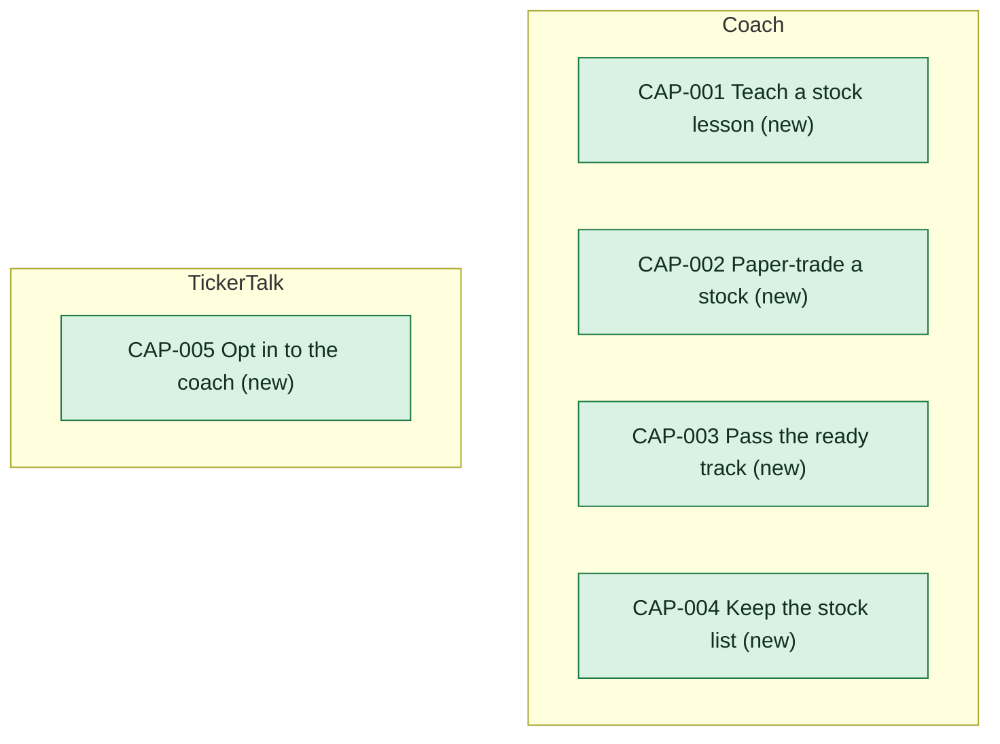

# Capability delta

The first release adds five capabilities, all new. [[coach-building-blocks|Coach]] provides four: teaching a stock lesson, paper-trading a stock, passing the ready track and keeping the stock list. [[tickertalk-building-blocks|TickerTalk]] provides the fifth, opting in to the coach. Each capability page says what provides it.

<!-- generated:capability-map sha=cd2bac59: do not edit, run vela render -->

Key: green: new in this initiative.
<!-- /generated:capability-map -->

## Capabilities

- [[CAP-001-teach-a-stock-lesson|Teach a stock lesson]]
- [[CAP-002-paper-trade-a-stock|Paper-trade a stock]]
- [[CAP-003-pass-the-ready-track|Pass the ready track]]
- [[CAP-004-keep-the-stock-list|Keep the stock list]]
- [[CAP-005-opt-in-to-the-coach|Opt in to the coach]]

## Allocation

<!-- generated:allocation sha=550480b1: do not edit, run vela render -->
**Allocation:** 7 requirements at assumption or later, 0 not allocated.

| Requirement | [[coach-building-blocks\|Coach]] | [[tickertalk-building-blocks\|TickerTalk]] |
|---|---|---|
| [[CAP-001-teach-a-stock-lesson#CAP-001.FR1 Learn one stock at a time\|CAP-001.FR1]] | holds the stock list and the lessons, serves a lesson only for a stock on the list, in any order, and never gates one lesson on another being finished (CON-001, CON-001) | shows the stock list, offers a lesson only on a listed stock in any order, and shows one stock's lesson at a time (CON-001, CON-001) |
| [[CAP-001-teach-a-stock-lesson#CAP-001.FR2 Keep the reader's place\|CAP-001.FR2]] | keeps, for each reader ID, the lessons finished, counts a repeat finish once, never records a lesson left part-way, and serves that set back as the reader's progress; the contract must guarantee a finished lesson stays finished and a part-done lesson never appears in the set (CON-001, CON-001, CON-005, CON-005) | marks lessons finished from the progress Coach sends, and keeps no progress of its own (CON-001, CON-001) |
| [[CAP-001-teach-a-stock-lesson#CAP-001.FR3 Label delayed prices\|CAP-001.FR3]] | reads delayed quotes from Quoteline for display only, puts each price in a lesson marked as delayed 15 minutes, and when the quote cannot be had in time sends "price unavailable" and never an earlier price; the contract must guarantee a price always arrives with its delayed label or as "price unavailable" and nothing else (CON-001, CON-001, CON-004, CON-004) | shows each price with the delayed label exactly as Coach sends it, and "price unavailable" with the rest of the lesson still shown; adds no price or label of its own and holds no quotes (CON-001, CON-001) |
| [[CAP-001-teach-a-stock-lesson#CAP-001.FR4 Show only approved wording\|CAP-001.FR4]] | serves a lesson to a reader only once it is recorded as passed by Brightwater, and serves the passed text unchanged, so a reworded lesson is withheld until passed again; the contract must guarantee every lesson sent is one recorded as passed, in the passed wording; conditional on [[11-unknowns-and-risks#UNK-062 Written confirmation of the board-demo exemption\|UNK-062]] for the Kestrel-only demo, which has no share here (CON-001, CON-001) | shows Coach's copy exactly as sent, with no editing, trimming, rewording or copy of its own; conditional on [[11-unknowns-and-risks#UNK-062 Written confirmation of the board-demo exemption\|UNK-062]] for the Kestrel-only demo (CON-001, CON-001) |
| [[CAP-001-teach-a-stock-lesson#CAP-001.FR5 Explain trades, suggest none\|CAP-001.FR5]] | serves lessons that explain how a trade works on equities only, writes no lesson text of its own, gives no trade idea for a particular reader and covers no options; the contract must guarantee that what Coach sends is lesson copy and listed stocks, with no field that rates, ranks or recommends a stock (CON-001, CON-001) | draws Coach's lessons and adds no commentary, ranking, highlight or option screen of its own that could read as a view on a stock (CON-001, CON-001) |
| [[CAP-001-teach-a-stock-lesson#CAP-001.FR6 Tell the reader when unavailable\|CAP-001.FR6]] | answers a lesson request within 3 seconds or the call counts as failed, serves a whole lesson or nothing, marks a lesson finished only on a complete finish, and keeps each reader's finished lessons through an outage; the contract must guarantee that Coach answers within 3 seconds, or TickerTalk shows unavailable (CON-001, CON-001) | when Coach is down, slow or lost mid-lesson, shows the plain "coach isn't available" message and no lesson or part of one, hides the coach's entry points, and leaves the news working (CON-001, CON-001) |
| [[CAP-001-teach-a-stock-lesson#CAP-001.FR7 Keep progress on dropped stocks\|CAP-001.FR7]] | marks a stock dropped when it leaves the list, keeps each reader's finished lessons on it and counts them toward ready, and serves no new or part-done lesson on it; the contract must guarantee a dropped stock's finished lessons stay in the progress and the ready answer and no lesson on it is served (CON-001, CON-001) | shows a dropped stock's finished lessons as still counting, offers no way to start or continue a lesson on it, and shows ready as Coach reports it (CON-001, CON-001) |
<!-- /generated:allocation -->
