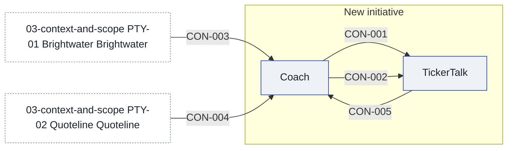

# Context and scope

TickerTalk is the foundation: an app, its readers and a mobile team. The product lead says about 400,000 people read it each month, and does not know whether the coach is for all of them or only those interested in trading. The coach is meant to take on one stock or option at a time. [[03-context-and-scope#PTY-01 Brightwater|Brightwater]], a broker-dealer TickerTalk signed with in June, holds the customers' money and executes equity orders through its API, and its agreement covers equities and not options. TickerTalk holds none of that money, and who carries the balances as owed to customers is not recorded. [[03-context-and-scope#PTY-02 Quoteline|Quoteline]] supplies the prices, under a licence that lets TickerTalk's own apps display US equity quotes delayed by 15 minutes, with no options data. A budget has been allocated, but its size, holder and scope are not recorded, and the dates and the no-live-trading ban are on the constraints page. [[sources#SRC-15|The product lead's own account]] is that a contractor, now locked in, writes the lessons, though the product lead does not have the name to hand. The product lead also defines what "ready" means for the track, and has not yet worked out what it looks like.

## Today

The product lead says TickerTalk is the foundation: the app, the readers and a mobile team. They also say "users are TickerTalk readers, about 400k monthly", and that the budget is allocated. All three are the product lead's account and none has a source. The agreement and licence summaries call TickerTalk "Kestrel", and [[sources#SRC-07|the product lead confirms]] they are the same company.

## After

<!-- generated:system-context sha=4a254c68: do not edit, run planner render -->

<!-- /generated:system-context -->

## In scope

- [[coach-building-blocks|Coach]], a new service for the lessons, the stock list and the paper record

## Out of scope

## Outside parties

### PTY-01 Brightwater

Brightwater is the broker-dealer TickerTalk signed with in June. [[sources#SRC-03|The partnerships manager's agreement summary]] says it opens accounts, runs KYC, holds customers' money and executes equity orders through its API, and that TickerTalk gets back an account ID and an order status and never holds customer money. The same summary says the agreement covers equities and not options, and that sandbox paper accounts are available for testing. [[sources#SRC-11|Partnerships' reading of the signed agreement in full]] confirms the equities-only scope and adds that options need a separate options agreement. It says Brightwater holds customers' balances as its own customers' money while TickerTalk never holds any, that the sandbox covers all US-listed equities, and that either side may leave with 90 days' notice. [[sources#SRC-13|Brightwater's own written reply]] says the Coach service may send paper orders to the sandbox through the existing API, and may show Brightwater's quotes inside its trade screens; it does not say whether those quotes are delayed or cover options. It says every lesson and screen shown to Brightwater's customers goes through Brightwater's content review first, which takes ten business days, and that live options trading needs its options agreement and each customer's options approval. Whether a reader who only paper-trades counts as a Brightwater customer for that review is not recorded.

- **Relationship:** partner
- **Agreements:** the signed broker agreement, June (year not recorded), held by the partnerships manager; [[sources#SRC-13|Brightwater's written reply]], [[sources#SRC-11|Partnerships' read of it in full]] and [[sources#SRC-03|the earlier summary]] are in sources, and the terms on consent, data and live trading are still open in [[11-unknowns-and-risks#UNK-009 Signed broker agreement terms|the question on its terms]]

### PTY-02 Quoteline

Quoteline supplies the market data under a licence. [[sources#SRC-04|The data engineer's licence summary]] says it lets TickerTalk's own apps display US equity quotes delayed by 15 minutes, and that it includes no options data. [[sources#SRC-10|Quoteline's own reply]] says showing delayed quotes inside lessons is display use, which the licence allows, and that using its prices to train or run a model is non-display use that needs an addendum with its own fees, as clause 9 says.

- **Relationship:** supplier
- **Agreements:** the Quoteline market data licence, summarised by the data engineer in March 2026 ([[sources#SRC-04|the summary]]); [[sources#SRC-10|Quoteline's reply of 14 October]] on clause 9; the licence itself is not in sources

### PTY-03 Outside Counsel

Outside Counsel is the legal adviser whose written reply on the first release is in sources. [[sources#SRC-08|The reply]] says lessons and paper trading may launch once the marketing, and any results shown to users, have been reviewed. It says a trade idea for a particular customer, this stock or this option now, counts as a recommendation, allowed only as Brightwater's recommendation under its duty to act in the customer's best interest and its supervision. It says TickerTalk must not trade on a customer's behalf in the first release, that options lessons are education, and that a live options trade needs Brightwater's options approval for that customer. Who reviews the marketing and the shown results is not recorded.

- **Relationship:** supplier
- **Agreements:** none known

## Value held for customers

### SV-01 Customer money at Brightwater

Brightwater holds the money customers put in, and TickerTalk holds none, on [[sources#SRC-01|the product lead's own account]].

- **Holder:** [[03-context-and-scope#PTY-01 Brightwater|Brightwater]]
- **Owner:** not known yet, see [[11-unknowns-and-risks#UNK-011 Who owes Brightwater balances|the question of who carries the balances]]
