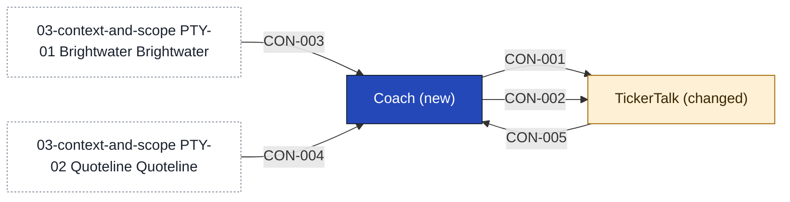

# Coach

Coach is the new service behind TickerTalk's coach screens. It teaches one stock at a time through lessons, keeps the ready track and each reader's progress, holds the list of about 50 stocks as data, and lets each reader paper-trade on Brightwater's sandbox accounts. [[11-unknowns-and-risks#UNK-029 Where the paper record lives|Where the paper record lives]] is still open, and if Coach does not hold it, whoever does needs ops and retention rules before paper trading ships. It also holds the release switch that gates the paper-trading part, as the product lead decided in [[2026-10-09-first-instruments#^c06]]. The product lead's own call is that the list is data, so a ruling from counsel changes the list and not the build ([[2026-10-09-first-instruments#^c05]]).

Coach places no real order and trades nothing for a reader, because [[sources#SRC-08|Outside Counsel's reply]] bars it in the first release. It covers no options, gives no trade idea for a particular reader, holds no money, which stays with Brightwater, and draws no screens, which stay in TickerTalk. It does not use Signal in release one. It does not write the lessons: [[11-unknowns-and-risks#UNK-018 Who writes the lessons and defines ready|who writes them]] is open. Where it runs is open too, see [[11-unknowns-and-risks#UNK-028 Where a Coach service can run|the question on a backend]]. Whether Coach or the sandbox is the record of a reader's paper trades is not decided, and the data concern has not been examined.

<!-- generated:app-context sha=d93846d2: do not edit, run planner render -->

<!-- /generated:app-context -->

## Containers

| Container | Job | Contracts served or used | Proposed by | State |
|---|---|---|---|---|
| Lessons and track | Holds the lessons, the ready track and each reader's progress | [[#CON-001 Lessons and track\|Lessons and track]] | claude | assumption |
| Stock list | Holds the list of about 50 stocks as data, and the release switch | [[#CON-001 Lessons and track\|Lessons and track]] | claude | assumption |
| Paper trading | Keeps the reader's paper balance and trades, and links to the sandbox | [[#CON-002 Paper trades\|Paper trades]], [[#CON-003 Brightwater sandbox\|Brightwater sandbox]] | claude | assumption |
| Price reader | Reads delayed quotes from Quoteline | [[#CON-004 Quoteline delayed quotes\|Quoteline delayed quotes]] | claude | assumption |

## Contracts this app provides

### CON-001 Lessons and track

Carries the lessons, the stock list and a reader's progress from Coach to TickerTalk, so the screens can show where the reader is and whether they are ready.

- **Crosses the boundary:** in, the reader's identity and the lesson they are on; out, the lessons, the stock list, the reader's progress and whether they are ready
- **Consumers:** [[tickertalk-building-blocks|TickerTalk]]
- **Change policy:** Coach only adds to the contract; removing or renaming anything needs TickerTalk's agreement, and Coach keeps serving the old shape until mobile says the last app version that uses it is retired
- **Tested by:** Coach, a provider test that serves lessons, list and progress, including a dropped stock's progress still counting toward ready, and that no field is removed or renamed; TickerTalk (mobile), a consumer test that the coach screens render from Coach's example responses
- **Change:** new
- **State:** decided

### CON-002 Paper trades

Carries a reader's paper orders from TickerTalk to Coach and their positions, balance and prices back, so no real order ever crosses.

- **Crosses the boundary:** in, a stock pick and a paper order; out, positions, balance, order status and delayed prices
- **Consumers:** [[tickertalk-building-blocks|TickerTalk]]
- **Change policy:** Coach only adds to the contract; removing or renaming anything, including an order status, needs TickerTalk's agreement, and Coach keeps serving the old shape until mobile says the last app version that uses it is retired
- **Tested by:** Coach, a provider test with a slow sandbox covering the pending order, the refused duplicate, the order and balance updating together, and a dropped stock's position sold or shown stale; TickerTalk (mobile), a consumer test that the screens render pending, filled and stale states
- **Change:** new
- **State:** decided

## Contracts from outside providers

### CON-003 Brightwater sandbox

Brightwater's sandbox opens paper accounts, takes paper orders and returns their status. [[sources#SRC-11|Partnerships' reading]] says it covers all US-listed equities, and whether the agreement allows it in a consumer product is [[11-unknowns-and-risks#UNK-009 Signed broker agreement terms|still open]].

- **Provider:** [[03-context-and-scope#PTY-01 Brightwater|Brightwater]]
- **Crosses the boundary:** in, a paper account request and paper orders; out, the account ID and order status
- **Consumers:** [[coach-building-blocks|Coach]]
- **Change policy:** set by the Brightwater agreement; either side may leave with 90 days' notice; Coach treats the notice as the trigger to freeze, showing each reader's last known positions and balance marked frozen with new paper orders switched off, which holds only if Coach is the record ([[11-unknowns-and-risks#UNK-029 Where the paper record lives|where the paper record lives]])
- **Tested by:** Coach, a consumer test against the sandbox covering opening an account, placing an order, getting its status, a slow answer, and the sandbox going away ending in frozen positions; Brightwater, not named yet, see [[11-unknowns-and-risks#UNK-037 Brightwater test side of the sandbox|Brightwater's test side of the sandbox]]
- **Change:** new consumers
- **State:** decided

### CON-004 Quoteline delayed quotes

Quoteline's delayed US equity quotes. [[sources#SRC-10|Quoteline's reply]] says showing them inside lessons is display use, which the licence allows; whether valuing paper trades on them is non-display use is not recorded.

- **Provider:** [[03-context-and-scope#PTY-02 Quoteline|Quoteline]]
- **Crosses the boundary:** out, US equity quotes delayed by 15 minutes
- **Consumers:** [[coach-building-blocks|Coach]]
- **Change policy:** set by the Quoteline licence; a clause 9 addendum is needed for non-display use; Coach uses the quotes for display only until [[11-unknowns-and-risks#UNK-038 Valuing paper trades on Quoteline quotes|valuing paper trades on Quoteline quotes]] is answered
- **Tested by:** Coach, a consumer test that quotes show as delayed by 15 minutes and labelled, and that no Coach path uses them to compute a balance or position value; Quoteline, not named yet, see [[11-unknowns-and-risks#UNK-038 Valuing paper trades on Quoteline quotes|valuing paper trades on Quoteline quotes]]
- **Change:** new consumers
- **State:** decided

## Contracts consumed

<!-- generated:contracts-consumed sha=47d34926: do not edit, run planner render -->
| Contract | Provider | Change policy | State |
|---|---|---|---|
| [[coach-building-blocks#CON-003 Brightwater sandbox\|CON-003 Brightwater sandbox]] | [[03-context-and-scope#PTY-01 Brightwater\|Brightwater]] | set by the Brightwater agreement; either side may leave with 90 days' notice; Coach treats the notice as the trigger to freeze, showing each reader's last known positions and balance marked frozen with new paper orders switched off, which holds only if Coach is the record ([[11-unknowns-and-risks#UNK-029 Where the paper record lives\|where the paper record lives]]) | decided |
| [[coach-building-blocks#CON-004 Quoteline delayed quotes\|CON-004 Quoteline delayed quotes]] | [[03-context-and-scope#PTY-02 Quoteline\|Quoteline]] | set by the Quoteline licence; a clause 9 addendum is needed for non-display use; Coach uses the quotes for display only until [[11-unknowns-and-risks#UNK-038 Valuing paper trades on Quoteline quotes\|valuing paper trades on Quoteline quotes]] is answered | decided |
| [[tickertalk-building-blocks#CON-005 Reader identity\|CON-005 Reader identity]] | [[tickertalk-building-blocks\|TickerTalk]] | not yet agreed | assumption |
<!-- /generated:contracts-consumed -->

## Capabilities

- [[CAP-001-teach-a-stock-lesson|Teach a stock lesson]]
- [[CAP-002-paper-trade-a-stock|Paper-trade a stock]]
- [[CAP-003-pass-the-ready-track|Pass the ready track]]
- [[CAP-004-keep-the-stock-list|Keep the stock list]]

## History

- **Decision:** [[2026-10-09-coach-page-contracts]]
- **Override:** GATE-4 by @sim-lead on 2026-10-09: UNK-028 waits on a check with the mobile lead by 14 October, and UNK-029 is Coach's own design call
- **Options considered:** Coach service behind TickerTalk (picked); Coach inside TickerTalk: rejected, the product lead says "news app stays news"; Coach plus a paper-trading gateway: rejected, two new services for a January demo and a seam that only pays off once real orders exist

#### CON-001 Lessons and track

- **Options considered:** Coach service behind TickerTalk (picked); Coach inside TickerTalk: rejected, the product lead says "news app stays news"; Coach plus a paper-trading gateway: rejected, two new services for a January demo and a seam that only pays off once real orders exist
- **Decision:** [[2026-10-09-coach-page-contracts]]
- **Override:** GATE-4 by @sim-lead on 2026-10-09: UNK-028 waits on a check with the mobile lead by 14 October, and UNK-029 is Coach's own design call

#### CON-002 Paper trades

- **Options considered:** Coach service behind TickerTalk (picked); Coach inside TickerTalk: rejected, the product lead says "news app stays news"; Coach plus a paper-trading gateway: rejected, two new services for a January demo and a seam that only pays off once real orders exist
- **Decision:** [[2026-10-09-coach-page-contracts]]
- **Override:** GATE-4 by @sim-lead on 2026-10-09: UNK-028 waits on a check with the mobile lead by 14 October, and UNK-029 is Coach's own design call

#### CON-003 Brightwater sandbox

- **Options considered:** Coach service behind TickerTalk (picked); Coach inside TickerTalk: rejected, the product lead says "news app stays news"; Coach plus a paper-trading gateway: rejected, two new services for a January demo and a seam that only pays off once real orders exist
- **Decision:** [[2026-10-09-coach-page-contracts]]
- **Override:** GATE-4 by @sim-lead on 2026-10-09: UNK-028 waits on a check with the mobile lead by 14 October, and UNK-029 is Coach's own design call

#### CON-004 Quoteline delayed quotes

- **Options considered:** Coach service behind TickerTalk (picked); Coach inside TickerTalk: rejected, the product lead says "news app stays news"; Coach plus a paper-trading gateway: rejected, two new services for a January demo and a seam that only pays off once real orders exist
- **Decision:** [[2026-10-09-coach-page-contracts]]
- **Override:** GATE-4 by @sim-lead on 2026-10-09: UNK-028 waits on a check with the mobile lead by 14 October, and UNK-029 is Coach's own design call
