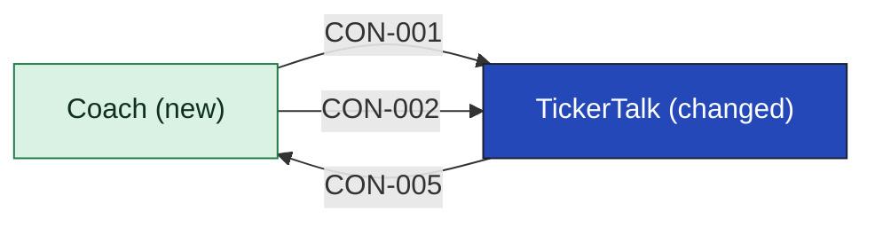

# TickerTalk

TickerTalk is the news app readers already use, and it stays the news app. For the first release it gains the coach screens: lessons, the stock list, progress, paper trades and delayed prices, all drawn from what [[coach-building-blocks|Coach]] sends. It tells Coach who the reader is, hides the coach when the release switch is off, and draws the coach's user-facing copy, whose writer is [[11-unknowns-and-risks#UNK-016 Coach's user-facing copy|still open]]. The product lead says, on [[sources#SRC-12|their own account]], that the mobile lead confirmed capacity for the first release.

TickerTalk keeps no lessons, stock list or paper record, places no order, and does not talk to Brightwater or Quoteline for the coach. It changes no news feature and shows no options. What TickerTalk holds today, and what it uses to tell who a reader is, [[11-unknowns-and-risks#UNK-030 What identifies a reader|is not recorded]]; the containers table lists only what this release adds.

<!-- generated:app-context sha=816c125f: do not edit, run planner render -->

<!-- /generated:app-context -->

## Containers

| Container | Job | Contracts served or used | Proposed by | State |
|---|---|---|---|---|
| Coach screens | The mobile screens for lessons and paper trades | [[coach-building-blocks#CON-001 Lessons and track\|Lessons and track]], [[coach-building-blocks#CON-002 Paper trades\|Paper trades]] | claude | assumption |

## Contracts this app provides

### CON-005 Reader identity

Tells Coach who the reader is, so lessons, progress and paper trades attach to the right person. How TickerTalk identifies readers is not recorded.

- **Crosses the boundary:** out, an identifier for the signed-in reader
- **Consumers:** [[coach-building-blocks|Coach]]
- **Change policy:** not yet agreed
- **Change:** new
- **State:** assumption

## Contracts consumed

<!-- generated:contracts-consumed sha=7202fbd7: do not edit, run planner render -->
| Contract | Provider | Change policy | State |
|---|---|---|---|
| [[coach-building-blocks#CON-001 Lessons and track\|CON-001 Lessons and track]] | [[coach-building-blocks\|Coach]] | Coach only adds to the contract; removing or renaming anything needs TickerTalk's agreement, and Coach keeps serving the old shape until mobile says the last app version that uses it is retired | decided |
| [[coach-building-blocks#CON-002 Paper trades\|CON-002 Paper trades]] | [[coach-building-blocks\|Coach]] | Coach only adds to the contract; removing or renaming anything, including an order status, needs TickerTalk's agreement, and Coach keeps serving the old shape until mobile says the last app version that uses it is retired | decided |
<!-- /generated:contracts-consumed -->

## Capabilities

Readers reach these through TickerTalk's screens. [[coach-building-blocks|Coach]] provides them.

- [[CAP-001-teach-a-stock-lesson|Teach a stock lesson]]
- [[CAP-002-paper-trade-a-stock|Paper-trade a stock]]
- [[CAP-003-pass-the-ready-track|Pass the ready track]]

## History

- **Options considered:** Coach service behind TickerTalk (picked); Coach inside TickerTalk: rejected, the product lead says "news app stays news"; Coach plus a paper-trading gateway: rejected, two new services for a January demo and a seam that only pays off once real orders exist

#### CON-005 Reader identity

- **Options considered:** Coach service behind TickerTalk (picked); Coach inside TickerTalk: rejected, the product lead says "news app stays news"; Coach plus a paper-trading gateway: rejected, two new services for a January demo and a seam that only pays off once real orders exist
