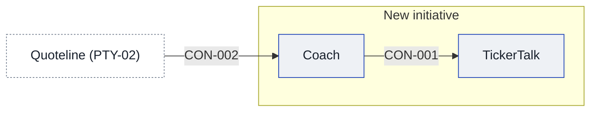

# Context and scope

## Today

- **TickerTalk:** 400,000 monthly users, per the product lead. No source yet. The CEO's memo names them the launch audience (assumption, SRC-04).
- **Brightwater:** a broker TickerTalk has been on API with since June, per the product lead. Terms are open, see [[11-unknowns-and-risks#UNK-004 Brightwater agreement terms|UNK-004]].
- **Signal:** an ML model that guesses next-day moves on fifty large-cap stocks, per the product lead. See [[11-unknowns-and-risks#UNK-005 Signal backtest|UNK-005]].
- **Brightwater, what it does (fact, SRC-01):** it opens accounts, does the identity checks, holds customer money and executes equity orders through its API. See [[#PTY-01 Brightwater]].
- **Brightwater, what Kestrel gets (fact, SRC-01):** an account ID and order status. Kestrel never holds customer money.
- **Brightwater, testing (fact, SRC-01):** it offers sandbox paper accounts.
- **Brightwater, options (fact, SRC-01):** the agreement covers equities only, and options are not covered. The product lead's full read says the same (SRC-05). See [[11-unknowns-and-risks#UNK-014 Options under the Brightwater agreement|UNK-014]].
- **Brightwater, customer-facing content (fact, SRC-01):** under section 7.2, trading content that Kestrel shows to Brightwater customers needs Brightwater's approval before use.
- **Brightwater, paper orders (assumption, SRC-07):** in its written reply, Brightwater says Coach may send paper orders to its sandbox through the API that already exists. The reply's date and who asked for it are open, see [[11-unknowns-and-risks#UNK-034 Date and origin of Brightwater's written reply|UNK-034]].
- **Brightwater, its quotes (assumption, SRC-07):** Brightwater says Coach may show Brightwater's quotes inside its trade screens. Which quotes the product would use is open, see [[11-unknowns-and-risks#UNK-008 Source and terms of quotes|UNK-008]].
- **Brightwater, content review (assumption, SRC-07):** every lesson and screen shown to Brightwater customers goes through Brightwater's content review first, and the review takes ten business days. See [[11-unknowns-and-risks#UNK-033 Brightwater's review time against counsel's launch condition|UNK-033]].
- **Brightwater, live options (assumption, SRC-07):** live options trading needs Brightwater's options agreement and each customer's options approval. Whether that agreement exists is open, see [[11-unknowns-and-risks#UNK-032 Brightwater's options agreement|UNK-032]].
- **Counsel, a trade idea is a recommendation (fact, SRC-06):** a trade idea for a particular customer, this stock or this option now, counts as a recommendation. Which counsel wrote this is open, see [[11-unknowns-and-risks#UNK-023 Which counsel wrote the reply and when|UNK-023]].
- **Counsel, who may recommend (fact, SRC-06):** such a recommendation is allowed only as Brightwater's own, under its Regulation Best Interest duty and its supervision.
- **Counsel, options lessons (fact, SRC-06):** options lessons count as education.
- **Counsel, live options trades (fact, SRC-06):** a live options trade needs Brightwater's options approval for that customer.
- **Counsel, lessons and paper trading (assumption, SRC-06):** they may launch once the marketing and any shown results are reviewed.
- **Counsel, trading for customers (assumption, SRC-06):** Kestrel must not trade on a customer's behalf in the first release.
- **Brightwater, the CEO's view (assumption, SRC-04):** the CEO's memo says Brightwater handles the brokerage side.
- **Signal, what was tested (fact, SRC-03):** the 50 largest US stocks by market value as of September 2026, over 2015 to 2025.
- **Signal, the result (fact, SRC-03):** the daily long-short portfolio returned 31% a year against 11% for the index. The size of the edge is disputed, see [[11-unknowns-and-risks#UNK-015 Size of Signal's edge|UNK-015]].
- **Signal, the ML team's next step (assumption, SRC-03):** the ML team plans to train Signal on TickerTalk users' watchlists to improve its picks. Whether TickerTalk's terms allow that is open, see [[11-unknowns-and-risks#UNK-006 TickerTalk terms and privacy notice|UNK-006]].
- **Signal, the CEO's view (assumption, SRC-04):** the CEO calls Signal the company's edge and says its backtest beats the market by 31% a year. The size of the edge is disputed, see [[11-unknowns-and-risks#UNK-015 Size of Signal's edge|UNK-015]].
- **Quoteline, what the license allows (fact, SRC-02):** US equity quotes delayed by 15 minutes may be shown in Kestrel's own apps. See [[#PTY-02 Quoteline]].
- **Quoteline, options (fact, SRC-02):** the license covers no options data.
- **Quoteline, other uses (fact, SRC-02):** clause 9 bars any use that is not display, including models, algorithms and derived data, unless a separate addendum is signed. Whether Signal's price data came from Quoteline is open, see [[11-unknowns-and-risks#UNK-020 Source of Signal's price data and clause 9|UNK-020]].
- **Compliance:** one consultant, two days a week, per the product lead.
- **Brightwater:** not yet contacted about this ask, per the product lead.
- **Outside counsel (fact, SRC-06):** a reply from outside counsel exists, but who asked for it, which counsel wrote it and when is open, see [[11-unknowns-and-risks#UNK-023 Which counsel wrote the reply and when|UNK-023]]. Until then, the earlier note that counsel had not been contacted no longer stands.
- **Teams:** the mobile team is on the news app, and the ML team is three people, per the product lead.
- **Who decides:** the CEO decides whether to move people, and the product lead pitches it.
- **Who knows:** nobody has been told yet. Mobile, ML, Partnerships and compliance are all unaware of the ask.
- **Brightwater agreement:** held by Partnerships and reachable through the Partnerships manager, with no stated need to explain why.

## After

<!-- generated:system-context sha=59269413: do not edit, run planner render -->

Key: blue outline: an app in the initiative · white, dashed: outside the initiative (a party or provider) · an arrow is a contract, labeled with its ID.
<!-- /generated:system-context -->

## In scope

- [[coach-building-blocks|Coach]]
- [[tickertalk-building-blocks|TickerTalk]]

## Out of scope

## Outside parties

### PTY-01 Brightwater

- **Relationship:** partner
- **Agreements:** the Brightwater API agreement, known only through a summary (SRC-01); the full text is still to fetch, see [[11-unknowns-and-risks#UNK-004 Brightwater agreement terms|UNK-004]]; a written reply from Brightwater (SRC-07) says what it allows for paper orders, quotes and content review, and that live options need an options agreement

### PTY-02 Quoteline

- **Relationship:** supplier
- **Agreements:** the Quoteline market data license, known only through a summary (SRC-02); the full text has not been fetched

## Value held for customers

### SV-01 Customer money at Brightwater

- **Holder:** [[#PTY-01 Brightwater]] (fact, SRC-01)
- **Owner:** not known yet, see [[11-unknowns-and-risks#UNK-018 Who owes customers their money|UNK-018]]
