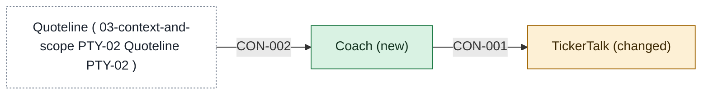

# Building blocks

One page per app in scope, named `<app>-building-blocks.md`. Contracts live on the provider's page.

<!-- generated:context-map sha=6c6bc5cc: do not edit, run planner render -->

<!-- /generated:context-map -->

## Coach app behind TickerTalk

- **Apps:** [[coach-building-blocks|Coach]] (new), [[tickertalk-building-blocks|TickerTalk]] (changed). Brightwater and Quoteline stay outside; Signal is not touched in release one.
- **Options considered:** Coach app behind TickerTalk (picked); Coach built into TickerTalk: rejected, "B drowns mobile, they're already maxed" (the product lead); Coach, a separate board-demo app and Signal as idea source: rejected, "C's too many apps before we know what Brightwater allows" (the product lead)
