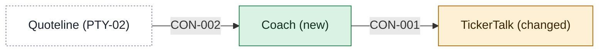

# Building blocks

One page per app: what it does, its main parts, and the contracts (agreed interfaces) it offers other apps. Each contract sits on the page of the app that provides it.

<!-- generated:context-map sha=84c35dd0: do not edit, run vela render -->

Key: green: new in this initiative · amber: changed by this initiative · white, dashed: outside the initiative (a party or provider) · an arrow is a contract, labeled with its ID.
<!-- /generated:context-map -->

## Coach app behind TickerTalk

- **Apps:** [[coach-building-blocks|Coach]] (new), [[tickertalk-building-blocks|TickerTalk]] (changed). Brightwater and Quoteline stay outside; Signal is not touched in release one.
- **Options considered:** Coach app behind TickerTalk (picked); Coach built into TickerTalk: rejected, "B drowns mobile, they're already maxed" (the product lead); Coach, a separate board-demo app and Signal as idea source: rejected, "C's too many apps before we know what Brightwater allows" (the product lead)
