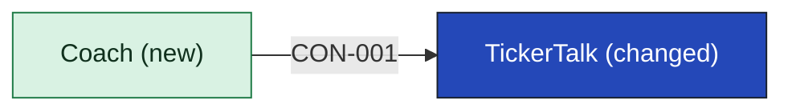

# TickerTalk

- **Options considered:** Coach app behind TickerTalk (picked); Coach built into TickerTalk: rejected, "B drowns mobile, they're already maxed" (the product lead); Coach, a separate board-demo app and Signal as idea source: rejected, "C's too many apps before we know what Brightwater allows" (the product lead)

TickerTalk keeps sign-in and the news, as it does today (the product lead, no source). It also hosts the way into [[coach-building-blocks|Coach]]: it shows an entry and passes the signed-in user's ID (CON-001).

TickerTalk holds no lessons, practice, quotes or progress; Coach keeps them. It prepares or places no order and holds no customer money, which Brightwater holds (SRC-01). It shows no way into the board demo and no trade ideas to customers.

<!-- generated:app-context sha=c123efaf: do not edit, run planner render -->

Key: dark blue: the app this page is about · green: new in this initiative · an arrow is a contract, labeled with its ID.
<!-- /generated:app-context -->

## Containers

| Container | Job | Contracts served or used | Proposed by | State |
|---|---|---|---|---|
| Coach entry | The screen and link that open Coach, hidden when Coach is down | CON-001 | claude | assumption |

TickerTalk's existing containers are not recorded; the mobile team holds them, see [[11-unknowns-and-risks#UNK-030 TickerTalk existing containers|UNK-030]].

## Contracts this app provides

None. Sign-in crosses to Coach through CON-001.

<!-- generated:contracts-consumed sha=5e416dcd: do not edit, run planner render -->
| Contract | Provider | Change policy | State |
|---|---|---|---|
| [[coach-building-blocks#CON-001 Coach entry\|CON-001 Coach entry]] | [[coach-building-blocks\|Coach]] | the Coach and TickerTalk owners agree any change to what crosses; the Coach owner approves before any change to the user ID ships. | decided |
<!-- /generated:contracts-consumed -->

Brightwater: the product lead says TickerTalk has been on Brightwater's API since June (no source). Whether release one uses that link is open, [[11-unknowns-and-risks#UNK-031 TickerTalk Brightwater link in release one|UNK-031]].
